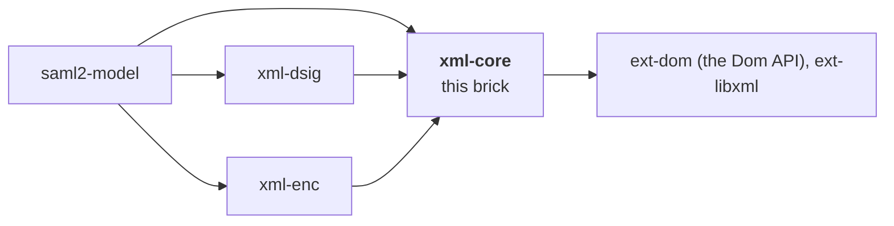

# saml-xml-core, specification

The `xml-core` brick of the SAML 2.0 stack: a safe DOM for XML that is about to be signed, verified, encrypted or decrypted. It parses without being attacked, finds an element by its ID without ambiguity, canonicalizes without ever hashing nothing, reads text as the signer meant it, and serializes what was built. It knows no signature, no cipher, no SAML and no HTTP.

| | |
|---|---|
| Repository | `beffroi-php/saml-xml-core` |
| Package, provisional name | `beffroi-php/saml-xml-core` |
| Namespace, provisional | `Beffroi\Xml\Core` |
| Runtime | PHP 8.4 or later, `ext-dom` (the `Dom\` API introduced in PHP 8.4), `ext-libxml`. Nothing else. |
| Consumers | `xml-dsig`, `xml-enc`, `saml2-model`; outside the stack, any XML Signature or XML Encryption profile (XAdES, WS-Security) |
| Design | Sub-spike 8a of [spike 8](https://github.com/Spomky-Labs/heidi-design/blob/main/spikes/08-saml/README.md) and [decision 0013](https://github.com/Spomky-Labs/heidi-design/blob/main/docs/decisions/0013-saml-formats-xml-ecrits-ici.md) of the identity provider's design repository |

This document is the whole repository until the sub-spike that builds the brick opens. It states what the brick does, what it refuses and what it guarantees; the code conforms to it, or the document changes first. Section 4 lists the invariants every test enforces, section 5 the public API and the compatibility promise, section 9 the corpus that judges the brick. Every figure in it is dated and sourced (section 13).

## 1. Why this brick exists

Three things go wrong in every XML security stack, and none of them is cryptography.

1. **The parser is attacked.** External entities read files and URLs (XXE), entity expansion exhausts memory (the billion laughs), XInclude pulls in other documents, a deep or huge document exhausts the process. libxml resolves none of this by default any more, but the flags that re-enable it are one option away, and a host application may have installed an entity loader for the whole process.
2. **The verifier reads what it did not verify.** XML Signature Wrapping (XSW) moves the signed element and puts an unsigned one where the consumer looks: eleven of the fourteen SAML frameworks tested in 2012 fell to it, and the class is alive in 2026 (CVE-2026-63182). Two parsers disagreeing on one document, over a DOCTYPE or a namespace, gave ruby-saml two authentication bypasses in 2025 (CVE-2025-25291, CVE-2025-25292). A comment inside a `NameID` splits its text node, and in 2018 several implementations read only the first half (CVE-2017-11428 and its siblings, CVE-2018-0489). `getElementById()` returns the first of two elements sharing an ID and says nothing.
3. **The primitive fails silently.** libxml's canonicalization returns `false` or an empty string on input it cannot process, and xmlseclibs hashed that empty string (CVE-2025-66578, December 2025). Its ID lookups built XPath expressions from the reference URI (GHSA-2g98-f9jv-w8c5, 2024).

The brick answers each with a rule in code. No rule has an option that turns it off, and the stack has no second way to parse, canonicalize or serialize: what this brick does not offer, the stack does not do.

## 2. Position



The brick depends on the two extensions and on nothing else: no PSR package, no cryptography, no `ext-openssl`, no `ext-mbstring`. Consumers manipulate `Dom\Element` nodes directly; the brick guards the boundaries (bytes in, bytes out, canonical bytes) and the lookups where the attacks live (an element by ID, the text of an element, the children of an element).

The `Dom\` API of PHP 8.4 (`Dom\XMLDocument`) is the one used, never `DOMDocument`. It throws on malformed input instead of returning `false`, exposes namespace declarations as attributes, returns `null` for an absent attribute, gives every node a stable PHP object identity (`$element->ownerDocument === $document` holds), and offers `getInScopeNamespaces()`. `Dom\XMLDocument` is a final class, which is why the brick recognises the documents it produced with a `WeakMap` rather than a subclass (section 6.1).

## 3. Threat model

Each row is an incident, the rule that answers it, and where the rule lives. The invariants are numbered in section 4; the corpus cases in section 9.

| Threat | Incident | Rule | Where |
|---|---|---|---|
| External entities, entity expansion, external DTD | The XXE family | A DOCTYPE is refused before parsing (byte scan) and after (`doctype` check); an entity reference node is refused; no parse flag ever loads a DTD or substitutes entities; no entity loader is installed | I-1, I-2, `Loader` |
| XInclude, network access during parsing | libxml features | `LIBXML_XINCLUDE` never set, `LIBXML_NONET` always set | I-2, `Loader` |
| Parser differential | ruby-saml, CVE-2025-25291 and CVE-2025-25292 | One parser, one DOM: the brick canonicalizes and serializes only documents it parsed or created itself, and no other XML parser exists in the stack | I-4, `Document::owning()`, section 8 |
| Signature wrapping | "On Breaking SAML" (2012), CVE-2026-63182 | One ID space per document, a duplicate ID refuses the whole document; navigation is by direct children only, no descendant search, no XPath; the element a consumer receives after verification is the re-parse of the canonical bytes that were hashed | I-8, I-9, I-11, I-14, section 6.6 |
| Comment-split text | Duo Labs 2018, CVE-2017-11428, CVE-2018-0489 | `Text::of()` concatenates every text and CDATA child; a child element is a refusal | I-12, `Text` |
| Empty canonical form | CVE-2025-66578 | `C14N()` returning `false` or `''` is an exception; a `CanonicalXml` cannot hold an empty string | I-13, `Canonicalizer`, `CanonicalXml` |
| Relative namespace URI | libxml's C14N fails on it, and the parser reports nothing | Every namespace declaration is checked at load: an absolute URI, or the empty undeclaration of the default namespace | I-6, `Loader` |
| Unbound prefix, empty prefixed namespace, `xml` or `xmlns` prefix misuse, XML 1.1 | libxml parses them and only emits a diagnostic | Any libxml diagnostic, whatever its level, refuses the document | I-3, `Loader` |
| Encoding tricks | UTF-16 with a BOM is accepted by libxml and then reported as UTF-8 | The bytes are valid UTF-8 and carry no UTF-16 or UTF-32 byte order mark, checked before parsing; a declared encoding is UTF-8 | I-5, `Loader` |
| XPath injection | GHSA-2g98-f9jv-w8c5 | No XPath expression exists anywhere in the brick, not even a fixed one; ID lookup is an index built at load, subtree exclusion is detach and reinsert | I-9, I-14, `Canonicalizer` |
| Denial of service | Deep, wide or huge documents; many namespace declarations make exclusive canonicalization expensive | Six bounds with defaults and ceilings, the byte bound checked before parsing; `LIBXML_PARSEHUGE` never set | I-7, `Limits` |
| Silent first match | `getElementById()` returns the first of two elements with the same ID (measured, section 13) | Never called; the brick's own index refuses duplicates | I-8, I-14 |

## 4. Invariants

Each invariant is code, never a constructor option or a flag, and has at least one test in the corpus of section 9.

- **I-1. No DOCTYPE, no entity.** Input whose bytes contain `<!DOCTYPE` is refused before parsing. A parsed document whose `doctype` is not `null`, or that contains an entity reference node, is refused. Only the five predefined entities and character references survive parsing, because nothing else is defined.
- **I-2. Fixed parse flags.** Parsing uses `LIBXML_NONET`, plus `LIBXML_NO_XXE` when the constant is defined. `LIBXML_NOENT`, `LIBXML_DTDLOAD`, `LIBXML_DTDATTR`, `LIBXML_DTDVALID`, `LIBXML_XINCLUDE`, `LIBXML_PARSEHUGE`, `LIBXML_NOBLANKS` and `LIBXML_NOCDATA` are never set. `libxml_set_external_entity_loader()` is never called.
- **I-3. A diagnostic is a refusal.** Parsing runs with `libxml_use_internal_errors(true)`, saved and restored in a `finally`. A thrown `DOMException` is a refusal (`MalformedXml`). A parse that completes but leaves any diagnostic in libxml's buffer, at any level, is a refusal (`ParserDiagnostic`).
- **I-4. One parser.** The brick canonicalizes and serializes nodes of documents it loaded or created, and refuses any other (`ForeignNode`). No other XML parser, `DOMDocument` included, is used by the brick or by its consumers (section 8).
- **I-5. UTF-8 and XML 1.0 only.** The bytes are valid UTF-8 (checked with PCRE's UTF mode before parsing) and do not start with a UTF-16 or UTF-32 byte order mark; a UTF-8 byte order mark is accepted. After parsing, `xmlVersion` is `1.0` and `xmlEncoding` compares equal to `UTF-8` case-insensitively.
- **I-6. Absolute namespaces.** Every namespace declaration in the document has an absolute URI (a scheme followed by a colon, RFC 3986 §3.1), except `xmlns=""`, which undeclares the default namespace. Every prefixed element or attribute has a namespace URI.
- **I-7. Bounded.** Size in bytes, depth, number of elements, attributes per element, namespace declarations and ID length are bounded by `Limits`, whose defaults and ceilings are in section 7. The byte bound is checked before parsing; the others in one traversal after it.
- **I-8. One ID space, no duplicate.** The ID attributes are those the consumer registers (`IdAttributes`). Their values form a single space per document; a value that appears twice, under the same attribute or under two different ones, refuses the whole document. A value that is not an NCName, or is longer than the bound, refuses it too.
- **I-9. Lookup by index, never by query.** `Document::elementById()` reads the index built at load. `getElementById()` and `setIdAttribute*()` are never called, and no XPath expression exists in the brick.
- **I-10. Names are namespace URI and local name.** Matching an element or an attribute compares its namespace URI and its local name (`Name`); a prefix is never compared.
- **I-11. Children only.** The brick offers direct-child navigation (`Children`) and nothing that searches descendants: `getElementsByTagName*()`, `querySelector*()` and XPath are never called.
- **I-12. Text is the concatenation of the text and CDATA children.** `Text::of()` returns them in document order, skipping comments and processing instructions; a child element, or any child of another type, is a refusal (`MixedContent`). This is the value that Canonical XML without comments signs.
- **I-13. Nothing canonicalizes to nothing.** `C14N()` returning `false` is an exception; a `CanonicalXml` refuses the empty string in its constructor. The brick contains exactly one call to `C14N()`.
- **I-14. Subtree exclusion is structural.** An element left out of a canonical form (the enveloped signature case) is detached from its parent before the call and reinserted at the same position in a `finally`. No XPath node set is built.
- **I-15. Faithful serialization.** A document is serialized with `formatOutput` false, an XML declaration and UTF-8; whitespace text nodes are kept at load and at serialization. The serializer of the `Dom\` API applies the namespace fix-up of the DOM Parsing and Serialization specification, which section 6.5 measures and bounds: what a consumer builds with one prefix per namespace round-trips byte for byte, and what it loaded is forwarded as received, never re-serialized.
- **I-16. Refusals name the rule, not the input.** An exception says which rule refused and, when libxml gives them, the libxml error code, the line and the column. It never carries the offending bytes, and never libxml's message, which quotes them.

## 5. Public API

Everything below is `final`. Value objects are `readonly` with public properties. Every method that refuses input declares what it throws. This is the compatibility surface of the package.

### 5.1 Names

```php
namespace Beffroi\Xml\Core;

final readonly class Name
{
    /** @param ?string $namespace null when the node is in no namespace (an unprefixed attribute, an element under xmlns="") */
    public function __construct(public ?string $namespace, public string $local) {}

    public static function of(\Dom\Element|\Dom\Attr $node): self;   // (namespaceURI, localName)
    public function matches(\Dom\Element|\Dom\Attr $node): bool;     // namespace URI and local name, never the prefix
    public function equals(self $other): bool;
}
```

### 5.2 Loading

```php
final readonly class Limits
{
    public function __construct(
        public int $maxBytes = 1_048_576,
        public int $maxDepth = 64,
        public int $maxElements = 10_000,
        public int $maxAttributesPerElement = 32,
        public int $maxNamespaceDeclarations = 512,
        public int $maxIdLength = 128,
    ) {}   // each value between 1 and the ceiling of section 7, else \InvalidArgumentException
}

final readonly class Loader
{
    public function __construct(private IdAttributes $idAttributes, private Limits $limits = new Limits()) {}

    /** @throws RefusedXml */
    public function load(string $bytes): Document;
}

final class Document
{
    // constructed by Loader and DocumentFactory only

    public function root(): \Dom\Element;

    /** @throws UnknownId */
    public function elementById(string $id): \Dom\Element;

    public function hasId(string $id): bool;

    /** The document a node belongs to, if the brick loaded or created it. @throws ForeignNode */
    public static function owning(\Dom\Node $node): self;
}
```

`load()` takes bytes, never a path or a stream: reading a file or a request body is the caller's business, and the byte bound is checked on what the caller hands over.

### 5.3 Identification

```php
final readonly class IdAttribute
{
    /**
     * @param Name    $attribute        the attribute, for instance Name(null, 'ID')
     * @param ?string $elementNamespace the namespace URI of the elements it applies to; null for any element
     */
    public function __construct(public Name $attribute, public ?string $elementNamespace = null) {}
}

final readonly class IdAttributes
{
    /** @param list<IdAttribute> $attributes */
    public function __construct(public array $attributes) {}

    public static function none(): self;
    public function withAttribute(IdAttribute $attribute): self;
}
```

What the SAML stack registers, for the record and for the tests of this brick; each consumer registers its own:

| Consumer | Element namespace | Attribute |
|---|---|---|
| `xml-dsig` | `http://www.w3.org/2000/09/xmldsig#` | `Id` |
| `xml-enc` | `http://www.w3.org/2001/04/xmlenc#` | `Id` |
| `saml2-model` | `urn:oasis:names:tc:SAML:2.0:assertion`, `urn:oasis:names:tc:SAML:2.0:protocol`, `urn:oasis:names:tc:SAML:2.0:metadata` | `ID` |

`xml:id` is not registered by anyone in the stack. A profile that needs it, or a namespaced ID attribute such as `wsu:Id`, registers `new IdAttribute(new Name('http://www.w3.org/XML/1998/namespace', 'id'))` and gets the same index and the same duplicate rule.

### 5.4 Canonicalization

```php
enum CanonicalizationMethod: string
{
    case Inclusive             = 'http://www.w3.org/TR/2001/REC-xml-c14n-20010315';
    case InclusiveWithComments = 'http://www.w3.org/TR/2001/REC-xml-c14n-20010315#WithComments';
    case Exclusive             = 'http://www.w3.org/2001/10/xml-exc-c14n#';
    case ExclusiveWithComments = 'http://www.w3.org/2001/10/xml-exc-c14n#WithComments';

    /** @throws UnknownCanonicalizationMethod */
    public static function fromUri(string $uri): self;
    public function isExclusive(): bool;
    public function withComments(): bool;
}

final readonly class InclusiveNamespaces
{
    /** @param list<string> $prefixes each an NCName or '#default' (Exclusive XML Canonicalization §4) */
    public function __construct(public array $prefixes) {}

    public static function none(): self;
    public static function fromPrefixList(string $prefixList): self;   // whitespace-separated, as the PrefixList attribute carries it
}

final readonly class Canonicalizer
{
    /**
     * The canonical form of $apex and its subtree, without the subtrees of $excluding.
     *
     * @param list<\Dom\Element> $excluding strict descendants of $apex left out, as the enveloped signature transform leaves out ds:Signature
     * @throws CanonicalizationFailed when libxml returns false or an empty string
     * @throws ForeignNode when $apex does not belong to a document of the brick
     * @throws \InvalidArgumentException when $apex is not connected to its document, when an element of its subtree without a prefix has no xmlns attribute in scope declaring its namespace, when an excluded element is not a strict descendant of $apex or is listed twice, or when $inclusiveNamespaces is not empty for an inclusive method
     */
    public function canonicalize(
        \Dom\Element $apex,
        CanonicalizationMethod $method,
        InclusiveNamespaces $inclusiveNamespaces = new InclusiveNamespaces([]),
        array $excluding = [],
    ): CanonicalXml;
}

final readonly class CanonicalXml
{
    /** @throws CanonicalizationFailed on '' */
    public function __construct(public string $bytes) {}
}
```

The set of methods is an enumeration because the protocol fixes it: the four are what Canonical XML 1.0 and Exclusive XML Canonicalization 1.0 define and what PHP's `C14N()` can express (an exclusive flag and a comments flag). Canonical XML 1.1 (`http://www.w3.org/2006/12/xml-c14n11`) is not reachable from PHP, so `fromUri()` refuses it like any unknown URI. A method that PHP learns to express one day is a case added here, not a class added elsewhere: the single `C14N()` call has to learn it anyway.

### 5.5 Reading

```php
final class Text
{
    /** @throws MixedContent when $element has a child that is neither text, CDATA, comment nor processing instruction */
    public static function of(\Dom\Element $element): string;
}

final class Children
{
    /** @return list<\Dom\Element> the element children of $parent, in document order */
    public static function all(\Dom\Element $parent): array;

    /** @return list<\Dom\Element> */
    public static function named(\Dom\Element $parent, Name $name): array;

    /** @throws MissingChild|AmbiguousChild */
    public static function one(\Dom\Element $parent, Name $name): \Dom\Element;

    /** @throws AmbiguousChild */
    public static function optional(\Dom\Element $parent, Name $name): ?\Dom\Element;
}

final class Attributes
{
    /** @throws MissingAttribute */
    public static function required(\Dom\Element $element, Name $name): string;

    public static function optional(\Dom\Element $element, Name $name): ?string;
}
```

### 5.6 Writing

```php
final readonly class DocumentFactory
{
    /** A new XML 1.0, UTF-8 document whose root is $root, created with createElementNS() and the given prefix, its namespace declared on it as an attribute (6.5). */
    public function create(Name $root, ?string $prefix = null): Document;
}

final readonly class Serializer
{
    /** @throws SerializationFailed when saveXml() returns false */
    public function serialize(Document $document): string;
}
```

Consumers build under `root()` with the `Dom\` API (`$root->ownerDocument->createElementNS()`, `appendChild()`, `setAttributeNS()`); the brick does not wrap the DOM. What must be signed is canonicalized (5.4); what must be sent is serialized (5.6). Nothing reformats a serialized document afterwards.

### 5.7 Exceptions

```php
namespace Beffroi\Xml\Core\Exception;

abstract class RefusedXml extends \RuntimeException {}

final class MalformedXml extends RefusedXml {}                 // libxml threw; its error code, line and column when known
final class ParserDiagnostic extends RefusedXml {}             // libxml parsed but reported something: its code, level, line and column
final class DoctypeRefused extends RefusedXml {}               // <!DOCTYPE in the bytes, a doctype node, an entity reference node
final class EncodingRefused extends RefusedXml {}              // not UTF-8, a UTF-16 or UTF-32 BOM, a declared encoding other than UTF-8
final class XmlVersionRefused extends RefusedXml {}            // xmlVersion other than 1.0
final class NamespaceRefused extends RefusedXml {}             // relative namespace URI, prefixed node without namespace
final class LimitExceeded extends RefusedXml {}                // one of the six bounds, named
final class DuplicateId extends RefusedXml {}
final class InvalidId extends RefusedXml {}                    // not an NCName, or longer than the bound
final class UnknownId extends RefusedXml {}
final class MixedContent extends RefusedXml {}
final class MissingChild extends RefusedXml {}
final class AmbiguousChild extends RefusedXml {}
final class MissingAttribute extends RefusedXml {}
final class CanonicalizationFailed extends RefusedXml {}
final class UnknownCanonicalizationMethod extends RefusedXml {}
final class SerializationFailed extends RefusedXml {}
final class ForeignNode extends \LogicException {}             // a node of a document the brick did not produce
```

A `RefusedXml` is input the brick refuses; a consumer catches the base class when it does not care which rule fired. A `\LogicException` or `\InvalidArgumentException` is a programming error of the caller and is never caught by the stack. Messages follow I-16.

## 6. Processing rules

### 6.1 Loading, in order

1. **Size.** `strlen($bytes)` above `maxBytes` refuses (`LimitExceeded`). Nothing else has read the input yet.
2. **Bytes.** A leading `FE FF`, `FF FE`, `00 00 FE FF` or `FF FE 00 00` refuses (`EncodingRefused`). `preg_match('//u', $bytes) !== 1` refuses (`EncodingRefused`). The check runs on 1.2 MB in 0.4 ms (section 13).
3. **DOCTYPE.** `str_contains($bytes, '<!DOCTYPE')` refuses (`DoctypeRefused`), wherever the sequence sits, in a comment or a CDATA section included. XML is case-sensitive: `<!doctype` is not a document type declaration and libxml refuses it as malformed. The false positive is accepted: no message of the stack carries that sequence.
4. **Parse.** An empty input refuses (`MalformedXml`) before anything is called: `createFromString('')` throws `ValueError`, not `DOMException` (measured, section 13). Then `$previous = libxml_use_internal_errors(true); libxml_clear_errors();` then `Dom\XMLDocument::createFromString($bytes, $flags)` with the flags of I-2, inside `try`. A `DOMException` becomes `MalformedXml` carrying the first diagnostic's libxml error code, line and column, never its message: libxml's messages quote the input (`Entity 'nope' not defined`, `Attribute x redefined`, `Opening and ending tag mismatch: b line 1 and a`, measured), which I-16 forbids, and their wording moves between libxml versions, which would tie the corpus to a build. When parsing completes, any diagnostic left in the buffer becomes `ParserDiagnostic` carrying its code, level, line and column, whatever the level: XML 1.1 is a level-1 warning, an unbound prefix a level-2 error, and both parse. The `finally` clears the buffer and restores `$previous`. A host that reads libxml's buffer reads it before calling the loader; the loader empties it.
5. **Document.** `doctype !== null` refuses (`DoctypeRefused`). `xmlVersion !== '1.0'` refuses (`XmlVersionRefused`). `strcasecmp($xmlEncoding, 'UTF-8') !== 0` refuses (`EncodingRefused`); an absent declaration reads as `UTF-8`, a lowercase `utf-8` declaration, which is what Entra emits, passes.
6. **Traversal.** One iterative pass in document order, with an explicit stack, over every node:
   - an **element**: its depth (the root is at depth 1) and the running element count against the bounds (`LimitExceeded`); a local name holding a colon, or a prefix with a `null` namespace URI, refuses (`NamespaceRefused`): the parser keeps a prefix it could not bind inside the local name (`prefix` `null`, `localName` `x:a`, measured) after a level-2 diagnostic that I-3 refuses first, so this check is the second layer; then its attributes, one by one:
     - an attribute in the `http://www.w3.org/2000/xmlns/` namespace is a **namespace declaration**: it counts against `maxNamespaceDeclarations`; its value is either empty, allowed only when the attribute is `xmlns` itself, or matches `^[A-Za-z][A-Za-z0-9+.-]*:` (`NamespaceRefused` otherwise);
     - any other attribute counts against `maxAttributesPerElement`; a local name holding a colon, or a prefix with a `null` namespace, refuses (`NamespaceRefused`), the same second layer; when its `Name` and the element's namespace match a registered `IdAttribute`, its value is at most `maxIdLength` bytes and an NCName (Namespaces in XML 1.0 §3, production `NCName`, over the character classes of XML 1.0 fifth edition §2.3), else `InvalidId`; a value already in the index refuses (`DuplicateId`); the element is indexed under it;
   - a **text** or **CDATA section** node: nothing, the byte bound covers it; whitespace-only text nodes are kept;
   - a **comment** or **processing instruction**: nothing, they are inert and Canonical XML covers them where it says so;
   - an **entity reference**, or any other node type: `DoctypeRefused`, only a DTD can produce one.
7. **Result.** A `Document` holding the root and the index, registered in `Internal\Registry` so that `Document::owning()` recognises every node of it. The registry is weak: a `Document` the caller drops is forgotten, and its nodes are foreign again. A node object keeps the libxml document alive, not the PHP object of its `Dom\XMLDocument` (measured, section 13), so the registry holds that object for as long as the `Document` is held, and a consumer that canonicalizes or serializes holds the `Document`, never a node alone.

Steps 5 and 6 run in `Internal\Inspector` on the parsed `Dom\XMLDocument`, so that the tests reach every rule with a document parsed outside the loader, DOCTYPE, XML 1.1 and unbound prefix included, which I-1 and I-3 stop before those steps through `load()`; Infection holds that class to the same bar as `Loader` (section 9).

Whitespace-only text nodes, CDATA sections and comments are kept exactly as parsed so that the canonical form of what was loaded is the canonical form of what was sent. The parser applies the end-of-line normalisation and the attribute value normalisation of XML 1.0 §2.11 and §3.3.3; the brick adds no normalisation of its own.

### 6.2 The ID index

The index maps each ID value to its element, over every registered attribute at once: a `saml:Assertion` with `ID="x"` and a `ds:Signature` with `Id="x"` in the same document are a duplicate and the document is refused. `elementById()` compares the string exactly and throws `UnknownId` when the value is absent. It never falls back to `getElementById()`, to `xml:id`, or to a search. Parsing the `URI` attribute of a signature reference (`#x`, `xpointer(id('x'))`) is the business of `xml-dsig`; the index receives the bare identifier.

A document created by `DocumentFactory` has an empty index: what a consumer builds, it holds by reference.

### 6.3 Canonicalization

`Canonicalizer::canonicalize()` is the only place in the stack that calls `C14N()`, and it proceeds so:

1. `Document::owning($apex)`, which throws `ForeignNode` for a node of a document the brick did not produce (I-4). An apex that is no longer connected to its document (`isConnected` false: removal from a parent does not clear `ownerDocument`) is a programming error, `\InvalidArgumentException`, checked before anything is detached; PHP itself refuses to canonicalize a detached node.
2. Every element of the apex's subtree that has no prefix is in the default namespace the `xmlns` attributes in scope declare, the ancestors of the apex included, a child in no namespace under a default namespace carrying its own `xmlns=""` (`\InvalidArgumentException` otherwise, before anything is detached). `C14N()` renders the namespace declarations that exist as attributes, or that PHP materialises for a prefixed name; a default namespace given to `createElementNS()` without an `xmlns` attribute is invisible to it, and so is the `xmlns=""` of a child in no namespace (measured, section 13): the canonical form of such an element carries no declaration, the signature computed over it is one the peer cannot verify, and its re-parse under 6.6 lands in another namespace. A loaded document always passes, the parser materialises every declaration as an attribute; only a built one can fail, which is a programming error of its builder, never input, hence the exception class. The walk costs about a millisecond on the document at the six default bounds (section 13).
3. Each element of `$excluding` is a strict descendant of `$apex`, listed once (`\InvalidArgumentException` otherwise, before anything is detached: an element listed twice would be detached twice). Each is detached with `removeChild()`, its parent and next sibling remembered.
4. `$apex->C14N($method->isExclusive(), $method->withComments(), null, $prefixes)`, where `$prefixes` is the list of `$inclusiveNamespaces`, or `null` when that list is empty: an empty array in inclusive mode makes PHP raise the notice "Inclusive namespace prefixes only allowed in exclusive mode" (measured), and a notice is a failure in the suite. The call sits in a `try` whose `finally` reinserts every detached element with `insertBefore()` at its remembered position, in reverse order of detachment. The document the caller holds is mutated for the duration of the call and is identical before and after it, whether the call succeeds or fails.
5. A `false` return, which libxml gives for a relative namespace URI or an entity reference node among other things, throws `CanonicalizationFailed`; libxml's error code is attached when there is one, never its message: the template of the relative namespace error is `Relative namespace UR is invalid here : %s`, the URI itself, and the call runs under the same saved, set and restored `libxml_use_internal_errors(true)` as the loader. An empty string, which libxml gives for an empty node set, is refused by the constructor of `CanonicalXml`.

Detaching a subtree and canonicalizing the rest gives the same bytes as the XPath node set `(.//. | .//@* | .//namespace::*)[not(ancestor-or-self::ds:Signature)]` that other implementations use for the enveloped signature transform, for both inclusive and exclusive canonicalization (measured, section 13). The brick takes the structural route because it has no XPath and wants none.

The `InclusiveNamespaces` prefixes are passed to libxml as they are; libxml renders `#default` as the default namespace declaration, as Exclusive XML Canonicalization §4 requires (measured). Passing a non-empty list with an inclusive method is a programming error: inclusive canonicalization renders every in-scope namespace already.

What canonicalization renders on the apex is what the specification says and what the tests pin: an inclusive form carries every namespace declaration in scope and the inherited `xml:*` attributes of the ancestors; an exclusive form carries the namespaces visibly utilised by the apex and its subtree plus the `InclusiveNamespaces` ones, and no inherited `xml:*` attribute.

### 6.4 Reading

`Text::of()` walks the direct children of the element: `Dom\Text` and `Dom\CDATASection` nodes are concatenated in order, `Dom\Comment` and `Dom\ProcessingInstruction` nodes are skipped, a `Dom\Element` child throws `MixedContent`, and so does any other child, an entity reference of a document the brick did not load among them: a text the brick cannot read whole is a text it does not read at all, which is the comment-split class of section 3. For `<NameID>user@example.com<!---->.evil.com</NameID>` the result is `user@example.com.evil.com`, which is the value that the signature over the canonical form without comments covers; `firstChild->nodeValue` would say `user@example.com`, and `textContent` on `<n>user<x>@evil</x>@example.com</n>` would say `user@evil@example.com`. Neither is used. Trimming is the consumer's decision, not the brick's.

`Children::*` look at the direct element children of one parent and match with `Name::matches()`. `one()` throws `MissingChild` when there is none and `AmbiguousChild` when there are two or more; `optional()` throws `AmbiguousChild` for two or more and returns `null` for none. A `saml:Assertion` wrapped inside a `samlp:Extensions` element is not a child of the response and is never found by a consumer that navigates from the root, which is what a signature wrapping relies on.

`Attributes::required()` throws `MissingAttribute`; both read with `getAttributeNS()`, which the `Dom\` API makes return `null` for an absent attribute.

### 6.5 Writing

`DocumentFactory::create()` calls `Dom\XMLDocument::createEmpty()` (XML 1.0, UTF-8), creates the root with `createElementNS()`, declares its namespace on it as an attribute (`xmlns`, or `xmlns:` and the prefix; nothing for a root in no namespace), appends it, registers the document in the `WeakMap` and returns the `Document`. `C14N()` renders the namespace declarations that exist as attributes, or that PHP materialises for a prefixed name, and a default namespace given to `createElementNS()` alone is invisible to it (measured, section 13): a consumer that builds under the root gives every element a prefix, or declares the default namespace it introduces with an `xmlns` attribute on the element itself, and 6.3 refuses what it forgot before anything is signed. `Serializer::serialize()` checks the document is the brick's, leaves `formatOutput` at `false`, calls `saveXml()` on the whole document and throws `SerializationFailed` on `false`. The result starts with `<?xml version="1.0" encoding="UTF-8"?>` and a line feed, then the root element.

Nothing in the brick pretty-prints. A signature is computed on a canonical form, and a document reformatted after signing is a document whose signature no longer verifies.

Two things do not survive a round trip through `saveXml()` then a parser, measured (section 13). A carriage return in a text node: `saveXml()` writes the byte as it is, and the parser of the peer normalises it to a line feed (XML 1.0 §2.11), so the canonical form of what was sent is not the canonical form of what was signed, which renders it `&#xD;` (the vector of Canonical XML 1.0 §3.4). A prefix bound to the URI of the default namespace in scope: `saveXml()` of the `Dom\` API is the XML serialization of the DOM Parsing and Serialization specification, with its namespace fix-up, and writes such an element without its prefix (Entra's metadata carries `<ds:KeyInfo xmlns:ds="…xmldsig#">` under `<Signature xmlns="…xmldsig#">` and comes back as `<KeyInfo xmlns:ds="…">`; a `p:b` created under a root in the default namespace `urn:x` comes back as `b`), which changes its canonical form, exclusive or inclusive. Two more are defects of `saveXml()` itself, found by the adversarial pass (section 9.7): adjacent CDATA sections are merged into one, so the junction of `a]]` and `>b` is written as a CDATA section holding `]]>`, which no parser accepts; and an ampersand in a namespace name is escaped twice, `&amp;#38;`, so the name changes on the way back. The canonical form is right in both cases. A consumer that builds a document to be signed writes no carriage return in a text node, one prefix per namespace, no adjacent CDATA sections and no ampersand in a namespace name, and never re-serializes a document it loaded in order to send it: it forwards the bytes it received. Whether the serializer refuses what would not round-trip is left to section 12.

### 6.6 The contract with xml-dsig

This section describes how the consumer of section 5 uses it; it specifies nothing of `xml-dsig` itself, only what this brick promises it.

When `xml-dsig` verifies a signature over an element `E` of a loaded document, it canonicalizes `E` (with the enveloped signature exclusion) into a `CanonicalXml`, hashes those bytes and compares the digest, verifies the signature over `SignedInfo`, and then **loads the same `CanonicalXml` bytes with the same `Loader`**. The `Document` that comes back has one root, the re-parsed `E`, with every namespace declaration and every inherited `xml:*` attribute the canonical form rendered, and no sibling, no ancestor, no wrapper, no second assertion. That root is what the consumer receives. The bytes that were hashed are the bytes that were parsed, so what the consumer reads is what the signature covered, byte for byte (XML Signature 1.1 §8.1.3, "See what is signed").

This is why the brick does not offer `importNode()` as the way to isolate a signed element: importing copies the element and the namespaces it uses, but drops the inherited `xml:*` attributes and the unused in-scope declarations that an inclusive form renders, so the copy is not the bytes that were hashed. Re-parsing the canonical form is exact, costs one `load()` on a few kilobytes, and runs the whole loader again, duplicate IDs included, on the subset.

## 7. Limits

| Bound | Default | Ceiling | Why this default, and what the ceiling protects |
|---|---|---|---|
| `maxBytes` | 1 048 576 (1 MiB) | 8 388 608 (8 MiB) | The largest document the stack handles is an entity's metadata: Entra's common federation metadata is 31 752 bytes; a SAML response with one assertion is a few kilobytes to a few tens of kilobytes. The default leaves a factor of thirty. The ceiling is a quantity no document of the stack approaches, and it is the one bound that runs before libxml builds the whole tree in memory: every other rule of 6.1 sees the document only once it is parsed. Aggregated metadata (eduGAIN) is outside the stack's scope. |
| `maxDepth` | 64 | 200 | Entra's metadata has depth 6; a response with an encrypted assertion stays under 12. libxml refuses depth 256 during parsing without `LIBXML_PARSEHUGE` (measured), which surfaces as `MalformedXml`; the ceiling stays below it so that, for every document libxml lets through, the bound that fires is the brick's. |
| `maxElements` | 10 000 | 1 000 000 | Entra's metadata has 166 elements. Parsing and traversing 100 000 elements takes 17 ms and 24 001 elements in 773 KiB take 18 ms (measured), so the bound is about memory, not time. |
| `maxAttributesPerElement` | 32 | 1 000 | No SAML element carries more than a dozen; Entra's metadata peaks at 2. Namespace declarations are counted separately. |
| `maxNamespaceDeclarations` | 512 | 10 000 | Entra's metadata declares 49. Inclusive canonicalization work grows with the elements times the declarations in scope, more than linearly in the declarations, while exclusive canonicalization barely moves (measured, section 13): at the defaults, 512 declarations on the root of a 10 000-element document, an inclusive form takes 5.3 s and an exclusive one 5 ms. This is the denial-of-service bound `xml-dsig` needs when the signer chooses the method; whether 512 is the right default is a question of section 12. Counted over the whole document. |
| `maxIdLength` | 128 | 1 024 | IDs of the interoperability targets are `_` followed by 32 hexadecimal digits or a GUID (33 to 37 bytes); SimpleSAMLphp's are 44. |

The defaults are provisional until the sub-spike measures the metadata of ADFS and SimpleSAMLphp and a response carrying an encrypted assertion; the ceilings are not. A bound is a quantity a caller may raise up to the ceiling for a documented reason; it is never a switch that removes a check.

## 8. What is refused, what is never called

**Refused input**, each with its exception and its corpus case: a DOCTYPE, wherever it is; an entity reference; bytes that are not UTF-8; a UTF-16 or UTF-32 byte order mark; a declared encoding other than UTF-8; XML 1.1; a libxml diagnostic of any level; an unbound prefix; an empty prefixed namespace; a relative namespace URI; a rebound `xml` or reused `xmlns` prefix; any of the six bounds exceeded; a duplicate ID; an ID that is not an NCName; an unknown canonicalization URI, Canonical XML 1.1 included; a node of a document the brick did not produce.

**Accepted, on purpose**: comments (Canonical XML defines their treatment and `#WithComments` methods exist), processing instructions (inert, and covered by the canonical form where they sit), CDATA sections, whitespace-only text nodes, a UTF-8 byte order mark, `xmlns=""`, `xml:lang`, `xml:space`, `xml:base` (read by nobody: the brick resolves no URI).

**Never called, in the brick and in its consumers**, enforced in the brick's own PHPStan configuration (`.ci-tools/phpstan.neon`): by `ekino/phpstan-banned-code` for the functions, since that extension bans function names and whole node types only, and by two rules of the repository (`tests/PhpStan/`) for the classes, the constants, the methods and the static calls, each confined call allowed in its one class and every dynamic call refused; under PHPStan, a test scans `src/` for the same tokens. The list is recommended, with the rules, to every consumer:

| Banned | Because |
|---|---|
| `DOMDocument`, `DOMXPath`, `Dom\XPath`, `SimpleXMLElement`, `simplexml_*`, `xml_parser_create*`, `XMLReader` | One parser, one DOM (I-4) |
| `libxml_set_external_entity_loader()`, `libxml_disable_entity_loader()` | I-2 |
| `LIBXML_NOENT`, `LIBXML_DTDLOAD`, `LIBXML_DTDATTR`, `LIBXML_DTDVALID`, `LIBXML_XINCLUDE`, `LIBXML_PARSEHUGE`, `LIBXML_NOBLANKS`, `LIBXML_NOCDATA` | I-2 |
| `getElementById()`, `setIdAttribute()`, `setIdAttributeNS()`, `setIdAttributeNode()` | I-9 |
| `getElementsByTagName()`, `getElementsByTagNameNS()`, `querySelector()`, `querySelectorAll()` | I-11 |
| `Dom\XMLDocument::createFromString()`, `createFromFile()`, `createEmpty()` outside `Loader` and `DocumentFactory` | I-4 |
| `C14N()`, `C14NFile()` outside `Canonicalizer` | I-13 |
| `saveXml()`, `saveXmlFile()` outside `Serializer` | I-15 |
| `importNode()`, `adoptNode()` | Section 6.6 |
| `xinclude()` | The method form of `LIBXML_XINCLUDE` (I-2) |
| `validate()`, `schemaValidate()`, `schemaValidateSource()`, `relaxNgValidate()`, `relaxNgValidateSource()` | Section 11: no validation, and a DTD is refused |
| `createEntityReference()` | I-1 |

The property reads `textContent`, `nodeValue` and `innerHTML` on an element cannot be banned by that tool; the brick does not use them, `Text::of()` is the way, and the review of every consumer checks it.

## 9. Acceptance

The brick is accepted when every case below is a green test in CI on PHP 8.4 and 8.5, when Infection leaves no escaped mutant in `Loader`, `Internal\Inspector`, `Canonicalizer`, `Text`, `Children` and `CanonicalXml`, and when the real documents of 9.4 load. The other half of sub-spike 8a's judge, `xml-dsig` verifying what SimpleSAMLphp signs and the reverse, exercises the contract of 6.6 and is specified with that brick.

### 9.1 Canonicalization vectors

Canonical XML 1.0 gives its examples in section 3. Five of the seven carry a document type declaration, put there to show that the DTD never appears in the canonical form (§3.1, §3.3, §3.4, §3.5, §3.7); only §3.2 and §3.6 have none, and §3.6 declares `ISO-8859-1`. The brick refuses a DOCTYPE (I-1) and an encoding other than UTF-8 (I-5), so the corpus holds each such original as a hostile case asserting `DoctypeRefused` or `EncodingRefused`, and a **derived** fixture, the same example with the declaration removed or changed, for the ones whose canonical form the declaration does not shape. Every derived fixture names its source section and the change made to it.

The vectors are transcribed from the rendered examples of the recommendation, its `<code>` blocks: a `<br/>` is a line feed, a `&nbsp;` a space, an entity its character. The rendered canonical form of §3.3 carries a space before every line break, an artefact of the HTML source that libxml2's own copy of the example (`test/c14n/without-comments/example-3.xml`, taken from an earlier draft of the recommendation) does not have and that the algorithm cannot produce; the fixture drops it and its README says so. A canonical form ends without a line feed.

| Section | Vector | Fixture | Method | Outcome |
|---|---|---|---|---|
| §3.1 | PIs, comments and nodes outside the document element | two derived fixtures, the `<!DOCTYPE doc SYSTEM "doc.dtd">` line removed from both since the external subset contributed nothing: **A** keeps the processing instructions and comments outside the document element, where an element apex never renders them; **B** moves them inside `doc`, in their order | Inclusive, and with comments | A: the `doc` line of the W3C's form, both variants; B: the W3C's form with those nodes rendered inside `doc`, both variants (measured, section 13). The canonical form of the document node itself is out of reach: the apex of 5.4 is an element |
| §3.2 | Whitespace in document content | the original | Inclusive | byte for byte |
| §3.3 | Start and end tags | derived: the declaration removed, and the expected output without the `attr="default"` that the DTD gave to `e9` | Inclusive | attributes sorted, empty elements expanded, single quotes normalised |
| §3.4 | Character modifications and character references | derived: the declaration removed, and the `normNames` and `normId` elements removed with it, since their attribute normalisation depended on the DTD's `NMTOKENS` and `ID` types | Inclusive | references replaced, special characters escaped, CDATA folded, `CDATA` attribute normalisation of XML 1.0 §3.3.3 |
| §3.5 | Entity references | none | | **refused by design**: the vector is about entities the DTD defines; the original asserts `DoctypeRefused` and nothing is derived |
| §3.6 | UTF-8 encoding | derived: the declared encoding, `ISO-8859-1`, changed to `UTF-8`; I-5 refuses the original, which is a hostile case asserting `EncodingRefused` | Inclusive | byte for byte: `<doc>`, the two bytes `C2 A9` of the copyright sign, `</doc>`, as the note under the example spells them out |
| §3.7 | Document subsets | none | | **refused by design**: an XPath-selected node set; the brick offers subtree exclusion only (I-14), and the enveloped case of 9.3 pins what it renders |

Exclusive XML Canonicalization has no vector suite of its own; the fixtures are built from its §2.1 example (`n1:elem1` enveloped in `n0:pdu`), from its §2.2 example (the `n0:local` document; its re-enveloped variant declares `xml:space="retain"`, a level-1 diagnostic for libxml that I-3 refuses, so the derived fixture says `preserve`) and from the four measured cases of section 13: an apex under ancestors declaring unused namespaces and `xml:lang`, rendered inclusive (everything), exclusive (visibly utilised only), exclusive with `PrefixList="unused"`, and exclusive with `PrefixList="#default"`. Each `CanonicalizationMethod` case has a test that the URI round-trips through `fromUri()`; the Canonical XML 1.1 URI asserts `UnknownCanonicalizationMethod`.

The primitive under test is libxml's, and the tests do not pretend otherwise: they pin the brick's mapping of methods to flags, its subtree exclusion, its prefix list handling and its guards, on outputs that the specification's own examples fix.

### 9.2 Hostile corpus

One fixture file per case under `tests/Fixture/hostile/`, each loaded through the `Loader` with the SAML stack's `IdAttributes` and the default `Limits`, each asserting the named exception and, where libxml gives one, the line.

| Case | Exception |
|---|---|
| Internal entity in a DOCTYPE, referenced in content | `DoctypeRefused` |
| External entity (`SYSTEM "file:///..."`, `SYSTEM "http://..."`), parameter entity, external DTD subset | `DoctypeRefused` |
| Billion laughs (nested entity expansion) | `DoctypeRefused`, before any expansion |
| `<!DOCTYPE` inside a comment, inside a CDATA section | `DoctypeRefused` (the accepted false positive) |
| `xi:include` element | loads (it is an ordinary element without the flag), and the corpus asserts no inclusion happened |
| One byte over `maxBytes` | `LimitExceeded`, before parsing |
| Depth 65 | `LimitExceeded` |
| Depth 300 | `MalformedXml`: libxml refuses at 256 during parsing, before the traversal runs |
| One element over `maxElements`, one attribute over `maxAttributesPerElement`, one declaration over `maxNamespaceDeclarations`, an ID one byte over `maxIdLength` | `LimitExceeded`, `LimitExceeded`, `LimitExceeded`, `InvalidId` |
| UTF-16LE with BOM, UTF-16BE with BOM, UTF-32 with BOM | `EncodingRefused`, before parsing |
| Declared `ISO-8859-1` | `EncodingRefused`: libxml converts and parses it, and the declared encoding is read after parsing (I-5) |
| Declared `UTF-16` over UTF-8 bytes | `MalformedXml`: libxml refuses the mismatch itself ("Document labelled UTF-16 but has UTF-8 content", code 81, measured) before anything reads `xmlEncoding` |
| Overlong UTF-8 sequence, a lone continuation byte | `EncodingRefused`, before parsing |
| `<?xml version="1.1"?>` | `ParserDiagnostic` (libxml warns) and, if the warning ever disappears, `XmlVersionRefused` |
| Unbound prefix on an element, on an attribute | `ParserDiagnostic` |
| `xmlns:x=""` | `ParserDiagnostic` |
| `xmlns:xml="urn:wrong"`, a prefix bound to the `xmlns` namespace name | `ParserDiagnostic` |
| Relative namespace URI (`xmlns:x="relative"`), which libxml parses without a diagnostic | `NamespaceRefused` |
| Duplicate attribute, unclosed tag, `NUL` byte, control character, `U+FFFE` | `MalformedXml` with line and column |
| Undefined entity reference (`&nope;`) without DOCTYPE | `MalformedXml` |
| Two `saml:Assertion` elements with the same `ID` | `DuplicateId` |
| A `saml:Assertion` `ID` equal to a `ds:Signature` `Id` | `DuplicateId` (one ID space) |
| `ID="1abc"`, `ID="a:b"`, `ID=""`, `ID=" _x"` | `InvalidId` |
| `ID="é"` | loads: a letter is an NCName start character |
| An element with `ID` in an unregistered namespace, duplicated | loads: unregistered attributes are not IDs, and `hasId()` is `false` |
| A document from a direct `Dom\XMLDocument::createFromString()` call that bypassed the `Loader`, handed to `Canonicalizer` or `Serializer` | `ForeignNode` |
| An apex removed from its parent (`isConnected` false) | `\InvalidArgumentException`, before any exclusion is detached |
| An excluded element that is not a descendant of the apex, the apex itself in `$excluding` | `\InvalidArgumentException`, and the document unchanged afterwards |
| A relative namespace created with `createElementNS('relative', 'x:b')` on a document of the brick, canonicalized | `CanonicalizationFailed` (libxml returns `false`) |
| `new CanonicalXml('')` | `CanonicalizationFailed` |
| `InclusiveNamespaces` with an inclusive method | `\InvalidArgumentException` |

### 9.3 Behaviour corpus

| Case | Expected |
|---|---|
| `<NameID>user@example.com<!---->.evil.com</NameID>` | `Text::of()` returns `user@example.com.evil.com`; the canonical form without comments is `<NameID>user@example.com.evil.com</NameID>`, with comments `<NameID>user@example.com<!---->.evil.com</NameID>` |
| `<n>a<![CDATA[<b>]]>c</n>` | `Text::of()` returns `a<b>c`; canonical `<n>a&lt;b&gt;c</n>` |
| `<n>user<x>@evil</x>@example.com</n>` | `MixedContent` |
| `<n><?pi x?>text</n>` | `Text::of()` returns `text` |
| A `saml:Assertion` inside `samlp:Extensions` and another as a direct child of the response | `Children::named(root, Assertion)` returns the direct child only; `one()` returns it |
| Two direct `saml:Assertion` children | `Children::one()` throws `AmbiguousChild`; `optional()` throws `AmbiguousChild` |
| No child of that name | `one()` throws `MissingChild`; `optional()` returns `null` |
| Same local name, other namespace (`<evil:Assertion xmlns:evil="urn:evil">`) | not matched by `Name(SAML_ASSERTION, 'Assertion')` |
| Same namespace, other prefix (`<x:Assertion xmlns:x="urn:oasis:names:tc:SAML:2.0:assertion">`) | matched: names compare namespace URI and local name |
| `Attributes::optional()` on an absent attribute | `null`, not `''` |
| A loaded document with whitespace between elements, serialized | the same bytes, declaration aside |
| Enveloped exclusion of `ds:Signature` under the root | canonical bytes identical to the XPath node-set form (the fixture carries both), the document unchanged afterwards; the same with the excluded element as first child, as last child, and with two excluded elements |
| A failing canonicalization with exclusions (relative namespace elsewhere in the apex) | `CanonicalizationFailed`, and the excluded elements are back in place |
| `Document::owning()` on a node of a loaded document, of a created document, and of a re-loaded canonical form | the right `Document` each time |
| A `Document` dropped by the caller | the `WeakMap` entry is gone (`Internal\Registry::count()`) |
| `DocumentFactory::create()` then `Serializer::serialize()` | `<?xml version="1.0" encoding="UTF-8"?>` on the first line, the root with its namespace declaration on the second, no indentation |
| Every serialized document of the fixtures | loads again through the `Loader` without refusal, and canonicalizes to the same bytes as before serialization; the §3.4 vector, which carries a carriage return in a text node, and Entra's metadata, which binds `ds` to its in-scope default namespace, are the measured exceptions of 6.5 and have their own tests |
| A document built by the factory without a prefix, with a prefixed child, a child declaring its own default namespace with `xmlns` and a child in no namespace declaring `xmlns=""` | canonicalizes with every declaration rendered, and to the same bytes after `serialize()` then `load()` |
| A built element without a prefix whose namespace no `xmlns` attribute in scope declares; a built child in no namespace under a default namespace without its own `xmlns=""` | `\InvalidArgumentException`, before anything is detached: an excluded element is still in place afterwards |

### 9.4 Real documents

Anonymised fixtures under `tests/Fixture/real/`, each named with its origin and the date it was captured, each loading without refusal with the SAML stack's `IdAttributes` and the default `Limits`, its IDs indexed, its exclusive canonical form stable across two runs:

- Entra: the common federation metadata (31 752 bytes on 2026-09-23, a UTF-8 byte order mark, no diagnostic, 166 elements, depth 6, 49 namespace declarations, one ID, encoding declared `utf-8`), a SAML response and an assertion captured from a test tenant when the sub-spike has one.
- ADFS: federation metadata and a response, when the sub-spike has a test farm.
- SimpleSAMLphp: IdP and SP metadata, an `AuthnRequest`, a response with a signed assertion, a `LogoutRequest`, from the container the spike runs.
- Okta: IdP metadata, if a developer tenant is available.

A real document that the loader refuses is a finding: either a rule is too strict and the specification changes here first, or the producer is wrong and the refusal is documented with the producer's name and the rule.

### 9.5 Performance

Two soft assertions in the suite, skipped outside CI: loading and indexing the largest fixture of 9.4 takes less than 50 ms, and loading a synthetic document at the six default bounds takes less than 500 ms. The measured baseline is 18 ms for 24 001 elements in 773 KiB on the development machine (section 13).

### 9.6 Test form

Every test, from the first, follows the maintainer's form: one behaviour per test, laid out as `// Given`, `// When`, `// Then`; a refusal written as `// Given`, then `// Then` with `expectException()` and `expectExceptionMessageIs()`, then `// When` with the call as the last statement; one behaviour on several inputs through `#[DataProvider]` with named cases; test names citing the section they verify (`itRefusesADoctypeBeforeParsing` with `XML 1.0 §2.8` in the docblock, `itRendersInheritedXmlAttributesInclusively` with `Canonical XML 1.0 §2.3`). Fixtures are files, one case per file, under `tests/Fixture/{canonical,hostile,behaviour,real}/`; a fixture that exists to be refused says so in its name.

### 9.7 Adversarial pass

Once the corpus above is green, each row of section 3 is attacked with inputs the corpus does not list: DOCTYPE placement and casing tricks, encoding and byte order mark variants, overlong and surrogate sequences, ID values that would collide after a normalisation the brick must not do (case, Unicode composition, whitespace), prefix rebinding and `xmlns` games, documents at and just over every bound, comments and processing instructions at every position, detached and foreign nodes, the prefix list of an exclusive canonicalization. Every attempt is a fixture whatever its outcome, `adversarial-<attempt>-refused.xml` under `hostile/` or `adversarial-<attempt>-loads.xml` under `behaviour/`, each asserted by the adversarial test with the exception and the message it got, or loading. A bypass is reported before it is fixed, with the change of this document it needs. The pass of 23 September 2026 made 116 attempts on the loader and 10 on the canonicalizer and the reading side, found no bypass, and found the two defects of `saveXml()` recorded in 6.5 through the round trip of its own fixtures.

## 10. Repository

Until the sub-spike opens, the repository holds this file. When it opens, it takes the shape of the maintainer's other libraries:

```
composer.json          beffroi-php/saml-xml-core, MIT, php >=8.4, ext-dom, ext-libxml; PSR-4 Beffroi\Xml\Core\ => src/,
                       Beffroi\Xml\Core\Tests\ => tests/; no dependency, dev ones included: the tools live in the phpqa image
src/                   Name, Loader, Limits, Document, IdAttribute, IdAttributes, CanonicalizationMethod, InclusiveNamespaces,
                       Canonicalizer, CanonicalXml, Text, Children, Attributes, DocumentFactory, Serializer, Exception/,
                       Internal/ (Inspector: the rules of 6.1 steps 5 and 6 on a parsed document; Registry: the two weak maps
                       of 6.1 step 7), marked @internal, outside the compatibility promise of section 5
tests/                 Unit/ (one class per class of src/, plus SourceGuardTest, TraceabilityTest, AdversarialTest,
                       RealDocumentsTest, PerformanceTest, and Regression/ with one class per row of section 3),
                       Support/ (the loading helpers, the SAML stack's ID attributes, the fixture reader, the direct parse
                       for foreign documents), PhpStan/ (the two rules of section 8), Fixture/ (canonical, hostile,
                       behaviour, real: 9.1 to 9.4 and the adversarial pass of 9.7, each canonical directory with a README)
castor.php, .castor/   the tasks: phpunit, phpstan, mago-format, mago-lint, rector, lint, composer-validate, infect, libxml,
                       prepare-pr
.ci-tools/             phpstan.neon (level max, strict rules, deprecation rules, phpunit, banned-code for the functions of
                       section 8, the two rules of tests/PhpStan for the rest), rector.php, phpunit.xml.dist
infection.json.dist    at the root, where Infection resolves the source directories of its git diff
mago.toml              the formatter and the linter
.github/workflows/     ci.yml on ghcr.io/spomky-labs/phpqa, PHP 8.4 and 8.5: format, lint, rector, phpstan, composer, syntax,
                       phpunit with coverage, infection on the files of section 9 then on the diff, every PHP job printing
                       the libxml version and whether LIBXML_NO_XXE is defined; dependency-review.yml; scorecards.yml;
                       release-on-milestone-closed.yml
LICENSE, README.md, SECURITY.md, CODE_OF_CONDUCT.md
```

`composer.json` lists no runtime dependency beyond the two extensions, and the CI's `composer validate` is what keeps it so; a dependency added is a change of this document first.

**Security policy.** Decision 0013 records that the existing PHP bricks fixed canonicalization and GCM flaws without a published advisory, and that the advisory databases missed others. `SECURITY.md` commits this package to the opposite: private reporting through GitHub, a GitHub Security Advisory published with every fix, a CVE requested for it, so that `composer audit` and Packagist see it.

**Versioning.** `0.x` while spike 8 runs, with this document as the changelog of intent; `1.0.0` when the first end-to-end consumer is green (the IdP role of sub-spike 8c). Semantic versioning on the surface of section 5 from then on: the enumeration cases, the exception classes and the constructor signatures are the promise.

## 11. Out of scope

Not built, not planned here, and not to be added to this package without a change of this document:

- XPath, XSLT, XPointer: `xml-dsig` refuses transforms and reference forms that need them; this brick offers none.
- Canonical XML 1.1 and 2.0: not reachable from PHP; refused as unknown methods.
- Validation against a DTD or an XML Schema: a DOCTYPE is refused, and the SAML schema proves nothing that matters.
- XInclude, `xml:base` resolution, any network or filesystem access.
- Streaming or pull parsing (`XMLReader`, SAX): the security rules need the whole tree.
- HTML, `Dom\HTMLDocument`.
- Signatures, digests, encryption, key material: `xml-dsig` and `xml-enc`.
- Anything SAML: namespaces, element names, validity windows, `NameID` formats belong to `saml2-model`.
- Reading files or requests: the loader takes bytes.

## 12. Left to the sub-spike

Each item becomes an issue on the spike's epic the day the sub-spike opens; none is built ahead.

- The six default bounds of section 7, once the metadata of ADFS and SimpleSAMLphp and a response with an encrypted assertion are measured. `maxNamespaceDeclarations` first: on 23 September 2026 the inclusive canonical form of a 10 000-element document costs 154 ms with 64 declarations in scope, 478 ms with 128, 2.4 s with 256 and 5.3 s with 512, the default (section 13); a signer who chooses inclusive canonicalization chooses that cost for the verifier.
- Whether a UTF-8 byte order mark stays accepted, once the interoperability targets are captured. **Answered on 23 September 2026**: Entra's common federation metadata starts with one (section 13), so the mark stays accepted (I-5) and the real fixture keeps it byte for byte.
- Whether `Serializer` refuses a document that would not round-trip (6.5): a carriage return in a text node, which `saveXml()` writes as it is and a parser normalises away; a prefix bound to the URI of the default namespace in scope, which the namespace fix-up of `saveXml()` drops; adjacent CDATA sections, which `saveXml()` merges; an ampersand in a namespace name, which `saveXml()` escapes twice. The last two are defects of PHP's serializer to report upstream.
- The default namespace of a built element, found on 23 September 2026 after the merge: `C14N()` on an element built with `createElementNS()` without a prefix and without an `xmlns` attribute renders no declaration, so a document built that way and signed before it is sent carries a signature its peer cannot verify (section 13). **Answered the same day**: the factory declares the namespace of its root as an attribute, 6.3 refuses an undeclared default namespace before anything is detached, and the defect is reported to php-src next to the two of `saveXml()`.
- Whether `LIBXML_NO_XXE` is set at all: neither the development machine nor the `phpqa` image has libxml 2.13, and a flag no test can exercise is a flag the corpus does not cover. **Answered on 23 September 2026**: the loader sets it when the constant is defined (I-2), in one expression with `LIBXML_NONET`; it is undefined on the development machine (libxml 2.9.13) and on both `phpqa` images (PHP 8.4.25 and 8.5.10, libxml 2.9.14), so the corpus does not cover it, and every PHP job of the CI prints the libxml version and whether the flag is defined (`castor libxml`) so that the gap is visible on every build rather than hidden.

## 13. Sources

**Specifications.**

- Extensible Markup Language (XML) 1.0, fifth edition, W3C, 2008: §2.3 common syntactic constructs (`Name`, `NameStartChar`), §2.8 document type declaration, §2.11 end-of-line handling, §3.3.3 attribute value normalisation, §4.1 character and entity references. https://www.w3.org/TR/xml/
- Namespaces in XML 1.0, third edition, W3C, 2009: §2.2 use of URI references as namespace names, §3 declaring namespaces (production `NCName`), §6.1 namespace scoping, §6.3 uniqueness of attributes. https://www.w3.org/TR/xml-names/
- Canonical XML Version 1.0, W3C Recommendation, 15 March 2001: §2.3 processing, §2.4 document subsets, §3 examples. https://www.w3.org/TR/2001/REC-xml-c14n-20010315
- libxml2's copy of the same examples, taken from an earlier draft (`http://www.uvic.ca` where the recommendation says `http://example.org`), used to cross-check the whitespace of the transcription: https://gitlab.gnome.org/GNOME/libxml2/-/tree/master/test/c14n
- Exclusive XML Canonicalization Version 1.0, W3C Recommendation, 18 July 2002: §2.1 a simple example, §2.2 general problems with re-enveloping (the `n0:local` document), §3 specification, §4 use in XML security applications (`InclusiveNamespaces PrefixList`, `#default`). https://www.w3.org/TR/2002/REC-xml-exc-c14n-20020718/
- XML Signature Syntax and Processing Version 1.1, W3C Recommendation, 11 April 2013: §4.4.3.2 the reference processing model, §4.4.3.3 same-document URI references, §6.6.4 enveloped signature transform, §8.1.1 only what is signed is secure, §8.1.3 "see" what is signed. https://www.w3.org/TR/xmldsig-core1/
- RFC 3986, Uniform Resource Identifier: Generic Syntax, §3.1 scheme. https://www.rfc-editor.org/rfc/rfc3986#section-3.1

**Incidents.**

- Somorovsky, Mayer, Schwenk, Kampmann, Jensen, "On Breaking SAML: Be Whoever You Want to Be", USENIX Security 2012: fourteen frameworks, eleven vulnerable to signature wrapping. https://www.usenix.org/conference/usenixsecurity12/technical-sessions/presentation/somorovsky
- Duo Labs, "Duo Finds SAML Vulnerabilities Affecting Multiple Implementations", 27 February 2018: the comment-split `NameID`; CVE-2017-11427, CVE-2017-11428 (GHSA-x2fr-v8wf-8wwv), CVE-2017-11429, CVE-2017-11430, CVE-2018-0489 (GHSA-4479-q654-wmq5), CVE-2018-7340. https://duo.com/blog/duo-finds-saml-vulnerabilities-affecting-multiple-implementations
- CVE-2019-3465, GHSA-pqm6-cgwr-x6pf: signature validation bypass in xmlseclibs before 3.0.3.
- CVE-2023-49087, GHSA-ww7x-3gxh-qm6r: validation of `SignedInfo` in simplesamlphp/xml-security.
- GHSA-2g98-f9jv-w8c5, 20 May 2024: XPath injection in xmlseclibs, user input incorporated into XPath expressions.
- CVE-2025-25291, GHSA-4vc4-m8qh-g8jm, and CVE-2025-25292, GHSA-754f-8gm6-c4r2, 12 March 2025: ruby-saml authentication bypasses by parser differential (DOCTYPE handling, namespace handling) between REXML and Nokogiri.
- CVE-2025-66578, GHSA-c4cc-x928-vjw9, 8 December 2025: xmlseclibs computes the digest over the empty string libxml2 returns when canonicalization fails; remediation "treat canonicalization failures (exceptions or nil/empty outputs) as fatal".
- CVE-2026-32313, GHSA-4v26-v6cg-g6f9, and CVE-2026-32600, GHSA-r353-4845-pr5p, 13 March 2026: missing AES-GCM authentication tag validation in xmlseclibs and simplesamlphp/xml-security; the `xml-enc` brick's concern, listed here because decision 0013 counts them.
- CVE-2026-63182, June 2026: signature wrapping in litesaml/lightsaml, as recorded by decision 0013.

**Measurements**, all on 22 September 2026, with the probe scripts of this document's session, on PHP 8.4.25 with libxml 2.9.13 (Homebrew, macOS) and, where stated, in `ghcr.io/spomky-labs/phpqa:8.5` (PHP 8.5.10, libxml 2.9.14). Every behaviour below is a test of section 9 once the brick exists.

- `Dom\XMLDocument::createFromString('<a>')` throws `DOMException` "XML fragment is not well-formed" and leaves the libxml error "Premature end of data in tag a" (level 3) in the buffer. `createFromString('')` throws `ValueError` "Argument #1 ($source) must not be empty" and leaves nothing in the buffer (23 September).
- A DOCTYPE with an internal entity parses with default options: `doctype` is set, the content holds a `Dom\EntityReference` node, `textContent` expands it, `saveXml()` writes `&x;` back, and `C14N()` returns `false` with "Node XML_ENTITY_REF_NODE is invalid here".
- `xmlns:x="relative"` parses with zero diagnostics; `C14N()` on the document returns `false` with "Relative namespace UR is invalid here" (code 1955 on libxml 2.9, followed by two "Internal error" entries of code 1). The same through `createElementNS('relative', 'x:b')` on a created document. The messages libxml leaves for malformed input quote it: "Entity 'nope' not defined" (code 26), "Attribute x redefined" (code 42), "Opening and ending tag mismatch: b line 1 and a" (code 76), "Premature end of data in tag a" (code 77) (23 September).
- `C14N()` with an XPath query selecting nothing returns `''`. `C14N()` on a detached node throws `DOMException` "Canonicalization can only happen on nodes attached to a document."
- Unbound prefix (element or attribute), `xmlns:x=""`, `xmlns:xml="urn:wrong"`, a prefix bound to the `xmlns` namespace: parsed, with level-2 diagnostics (codes 200 and 201). The `Dom\` API keeps an unbound prefix inside the local name: `<x:a y:b="1"/>` gives an element with `prefix` `null`, `localName` `x:a`, `namespaceURI` `null`, and an attribute with `prefix` `null`, `localName` `y:b` (23 September). `<?xml version="1.1"?>`: parsed, level-1 diagnostic "Unsupported version '1.1'" (code 97).
- UTF-16LE bytes with a BOM parse and the document reports `xmlEncoding` `UTF-8`. A declared `UTF-16` over UTF-8 bytes throws (`DOMException`, libxml code 81 "Document labelled UTF-16 but has UTF-8 content"). Invalid UTF-8 without a declaration throws "Input is not proper UTF-8". A declared `ISO-8859-1` is converted and parses, `xmlVersion` and `xmlEncoding` reporting what was declared. No declaration reports `UTF-8`; a lowercase `utf-8` declaration reports `utf-8`.
- Depth 300 without `LIBXML_PARSEHUGE` throws "Excessive depth in document: 256". An 11 000 000-byte text node parses without it.
- `getElementById('x1')` returns `null` for plain `ID` attributes and the element for `xml:id`; after `setIdAttribute('ID', true)` on two elements sharing `ID="x1"`, it returns the first and reports nothing.
- `<n>user@example.com<!---->.evil.com</n>`: three child nodes; `firstChild->nodeValue` is `user@example.com`; `textContent` is `user@example.com.evil.com`; `C14N()` is `<n>user@example.com.evil.com</n>` and `C14N(false, true)` is `<n>user@example.com<!---->.evil.com</n>`. `<n>user<x>@evil</x>@example.com</n>` has `textContent` `user@evil@example.com`.
- A node object keeps the libxml document alive, not the PHP object of its `Dom\XMLDocument`: once every reference to that object is dropped, `$element->ownerDocument` creates a new object, and a `WeakMap` keyed by the old one no longer recognises it; `$element->ownerDocument === $document` holds only while `$document` is held (23 September).
- Namespace declarations are exposed as `Dom\Attr` nodes in the `http://www.w3.org/2000/xmlns/` namespace (`xmlns:s` has prefix `xmlns` and local name `s`; `xmlns` has a `null` prefix and local name `xmlns`). `getInScopeNamespaces()` and `getDescendantNamespaces()` return `Dom\NamespaceInfo` objects. `getAttributeNS(null, 'missing')` returns `null`. `querySelector()` exists on `Dom\Element`. `Dom\XMLDocument` is final. `$element->ownerDocument === $document` and `$document->documentElement === $document->documentElement` hold; a `WeakMap` keyed by the document recognises `$element->ownerDocument`.
- `C14N(false, false, null, [])` and `C14N(false, false, null, ['unused'])` both raise the PHP notice "Inclusive namespace prefixes only allowed in exclusive mode" and render the inclusive form; `C14N(false, false, null, null)` raises nothing (23 September).
- Inclusive canonicalization of `<s:a>` under `<root xmlns:s xmlns:x xmlns:unused xml:lang="fr">` renders `xmlns:s`, `xmlns:unused`, `xmlns:x` and `xml:lang="fr"`; exclusive renders `xmlns:s` and `xmlns:x`; exclusive with prefix list `unused` adds `xmlns:unused`; exclusive with `#default` renders the default namespace of an ancestor; an unknown prefix in the list changes nothing. `importNode()` of the same element renders `xmlns:s` and `xmlns:x` only. Re-parsing the canonical bytes yields the element with its namespace and its namespaced attribute.
- Detaching `ds:Signature`, canonicalizing the root and reinserting gives, inclusive and exclusive, exactly the bytes of `C14N()` with the node set `(.//. | .//@* | .//namespace::*)[not(ancestor-or-self::ds:Signature)]`, and the restored document canonicalizes as before.
- `preg_match('//u')` validates 1 200 000 bytes in 0.4 ms and returns `false` on `C0 AF`.
- The cost of `C14N()` on the root of a document of 9 999 empty elements under a root declaring N prefixes, PHP 8.4.25 and libxml 2.9.13 on the development machine (23 September): inclusive 1.8 ms for N = 2, 10.8 ms for 16, 154 ms for 64, 478 ms for 128, 2.4 s for 256 and 5.3 s for 512; exclusive between 2 and 5 ms whatever N. With N = 512, inclusive costs 504 ms for 1 000 elements, 2.5 s for 5 000 and 5.3 s for 9 999: linear in the elements, more than linear in the declarations. The document at the six default bounds of section 9.5 loads in 13 ms, canonicalizes exclusively in 5 ms and inclusively in 5.0 s. Entra's metadata, 49 declarations over 166 elements, canonicalizes in 0.1 ms either way. 100 000 elements parse and iterate in 17 ms; a 773 KiB document of 24 001 elements parses and traverses iteratively in 18 ms and canonicalizes exclusively in 7 ms.
- `Dom\XMLDocument::saveXml()` applies the namespace fix-up of the DOM Parsing and Serialization specification: `<a xmlns="urn:x"><p:b xmlns:p="urn:x"><p:c/></p:b></a>` is written `<a xmlns="urn:x"><b xmlns:p="urn:x"><c/></b></a>`, whose exclusive canonical form is `<a xmlns="urn:x"><b><c></c></b></a>` where the original's is `<a xmlns="urn:x"><p:b xmlns:p="urn:x"><p:c></p:c></p:b></a>`; a `p:b` created with `createElementNS('urn:x', 'p:b')` under a root in the default namespace `urn:x` is written `<b/>` while its exclusive canonical form is `<p:b xmlns:p="urn:x"></p:b>`; the reverse, a default-namespace child under a prefixed parent of the same URI, and two prefixes bound to one URI, are written as they are. Entra's federation metadata serialized and loaded again loses the nine `ds:` prefixes under its `Signature` element, 26 bytes of canonical form (23 September).
- `Dom\XMLDocument::createEmpty()` has `formatOutput` `false`, version `1.0`, encoding `UTF-8`; `saveXml()` writes the declaration, a line feed and the root. `saveXml()` writes a carriage return of a text node as the byte itself, which the parser normalises to a line feed on the next load: the vector of Canonical XML 1.0 §3.4, canonicalized as `First line&#xD;` then a line feed, canonicalizes as `First line` then a line feed after a round trip (23 September).
- `LIBXML_NO_XXE` is undefined on both PHP builds (it needs libxml 2.13), confirmed on 23 September on the `phpqa` 8.4 and 8.5 images, PHP 8.4.25 and 8.5.10 on libxml 2.9.14; `LIBXML_NONET`, `LIBXML_NOENT`, `LIBXML_DTDLOAD`, `LIBXML_DTDATTR`, `LIBXML_DTDVALID`, `LIBXML_XINCLUDE`, `LIBXML_PARSEHUGE`, `LIBXML_NOBLANKS`, `LIBXML_NOCDATA` are defined.
- Entra's common federation metadata, `https://login.microsoftonline.com/common/FederationMetadata/2007-06/FederationMetadata.xml`: 31 752 bytes, no `<!DOCTYPE`, valid UTF-8, a UTF-8 byte order mark (`EF BB BF`, the first three bytes of the 31 752; the measurement of 22 September reported none and was wrong, the capture of 23 September was checked with `xxd`), parsed in 0.1 ms with no diagnostic, version `1.0`, encoding `utf-8`, root `{urn:oasis:names:tc:SAML:2.0:metadata}EntityDescriptor`, 166 elements, depth 6, 49 namespace declarations, at most 2 attributes on an element, one ID, no duplicate, no relative namespace, no processing instruction, no comment, largest text node 1 028 bytes; exclusive canonical form 32 095 bytes in 0.1 ms.

**Measurements, 23 September 2026**, on the same builds, before the code of the brick is written, and during the adversarial pass of section 9.7 once it was.

- The adversarial pass, on the loader: a lowercase or mixed-case `<!doctype` is malformed for libxml (code 68); a `<!DOCTYPE` after the root, after a UTF-8 byte order mark, inside a processing instruction or inside an attribute value is caught by the byte scan; two duplicate `xml:id` values are a libxml diagnostic of their own (code 513, level 2) though nobody registers `xml:id`; a namespace name holding a space or a line feed is a diagnostic (code 99, level 2); a relative default namespace is a level-1 diagnostic (code 100) where a relative prefixed one is silent; `xmlns:xmlns`, a default namespace bound to the `xmlns` or the `xml` namespace name are diagnostics (code 200); two prefixes bound to one namespace name carrying the same attribute twice is a diagnostic (code 203); `xmlns:xml` bound to its own name is accepted; a prefix rebound on a child is accepted and the names compare by URI; `_a` and `_A`, and U+00E9 against `e` U+0301, are distinct IDs; U+1F600 is an NCName start character (XML 1.0 fifth edition §2.3); U+0085 and U+1FFFE are accepted characters; a document of exactly `maxBytes` bytes with a byte order mark loads, a single text node or attribute value of a mebibyte loads, 32 attributes and 512 declarations on one element load; a comment before the declaration, a `--` inside a comment, a processing instruction named `xml` or `XML` inside the root, a `]]>` in text and two root elements are malformed.
- The adversarial pass, on the canonicalizer and the reading side: `appendChild()` of a node of another document throws `DOMException` "Wrong Document Error", since `importNode()` and `adoptNode()` are never called, so a foreign subtree never enters a document of the brick; an apex inside a detached subtree is not connected; a prefix of the list that names no declaration, `xml`, `xmlns` or a name with a colon changes nothing, an empty prefix is read by libxml as the default namespace like `#default`, and a list of ten thousand prefixes costs 1.5 ms; an assertion wrapped in `samlp:Extensions` under another prefix of its namespace is not a child of the response, and the index reaches it by ID, being per document.

- The examples of Canonical XML 1.0 §3, transcribed from the rendered recommendation, derived as section 9.1 says and canonicalized with `C14N()` on the `doc` element: §3.1 A gives `<doc>Hello, world!</doc>` and, with comments, `<doc>Hello, world!<!-- Comment 1 --></doc>`; §3.1 B, the outside nodes moved inside `doc`, gives the W3C's lines concatenated inside `doc`, the processing instruction `<?pi-without-data     ?>` rendered `<?pi-without-data?>` and `<?xml-stylesheet   href="doc.xsl"` rendered with one space after its target; §3.2, §3.3 (without `attr="default"`), §3.4 (without `normNames` and `normId`) and §3.6 (declared `UTF-8`, or no declaration) match the recommendation byte for byte once the trailing spaces of the rendered §3.3 form are dropped. The original §3.6, declared `ISO-8859-1`, parses with `xmlEncoding` `ISO-8859-1` and canonicalizes to the same bytes: only I-5 refuses it. `C14N()` on the document node of §3.1 A renders the W3C's document-node form, both variants; the brick offers no document apex.
- Exclusive XML Canonicalization §2.1, `n1:elem1` inside `n0:pdu`: inclusive renders `xmlns:n0` and `xmlns:n1`, exclusive `xmlns:n1` alone. §2.2, `n1:elem2` inside `n0:local`: inclusive renders `xmlns:n0`, `xmlns:n1`, `xmlns:n3` and `xml:lang`, exclusive `xmlns:n1` and `xml:lang`, with `xmlns:n3` moved down to `n3:stuff`. The re-enveloped document of §2.2 declares `xml:space="retain"`: libxml parses it with a level-1 diagnostic, "Invalid value "retain" for xml:space" (code 102).

**Measurements, 23 September 2026, after the merge**, on the `phpqa` images (PHP 8.4.25 and 8.5.10, libxml 2.9.14), with the classes of the brick where stated.

- `C14N()` on an element built with `createElementNS()` renders only the namespace declarations that exist as attributes, or that PHP materialises for a prefixed name. Through `DocumentFactory::create(new Name('urn:samlp', 'Response'))` with the default `$prefix = null` and a child `Issuer` created in `urn:saml`, the exclusive and inclusive forms were `<Response><Issuer>idp</Issuer></Response>`, without a declaration, before the factory declared its root's namespace; after `serialize()` then `load()`, `<Response xmlns="urn:samlp"><Issuer xmlns="urn:saml">idp</Issuer></Response>`. The same document built with the prefixes `samlp` and `saml`, or with an explicit `xmlns` attribute on each element, gives the same bytes before and after the round trip. A built child in no namespace under `xmlns="urn:1"` is rendered `<e></e>` where the re-parse renders `<e xmlns=""></e>`; a built child in `urn:2` under `xmlns="urn:1"`, `<c></c>`, silently in `urn:1`. A prefixed built element renders its declaration, on itself when the prefix is unbound or bound to another name above it (`<p:c xmlns:p="urn:2">` under `xmlns:p="urn:1"`), nowhere when the same binding is in scope; a built `xsi:type` attribute renders `xmlns:xsi`, `xml:lang` renders as such. The legacy `DOMDocument` renders the default namespace of a built element. `getAttributeNS('http://www.w3.org/2000/xmlns/', 'xmlns')` returns the value of an `xmlns` attribute, `''` for `xmlns=""`, `null` when the element carries none, on loaded and on built elements alike.
- The walk of 6.3 step 2 over the 10 000 elements of the document at the six default bounds: `canonicalize()` exclusive takes 6.2 to 6.8 ms against 5.4 ms for `C14N()` alone, about a millisecond; 0.1 ms on Entra's metadata, unchanged.
