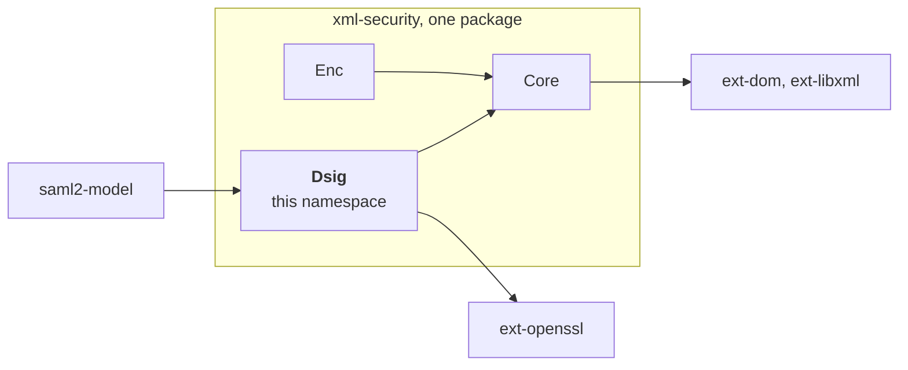

# xml-security, the `Dsig` namespace: specification

The `Dsig` namespace of `xml-security`, XML Signature on the safe DOM of `Core`: it signs an element and verifies a signature while never reading anything but what the signature covers. It knows no SAML and no HTTP: `saml2-model` decides which element is signed and where its `Signature` sits, `Dsig` decides whether the signature holds.

| | |
|---|---|
| Repository | `beffroi-php/xml-security`, one package for the safe DOM, XML Signature and XML Encryption, in three namespaces |
| Package | `beffroi-php/xml-security` |
| Namespace | `Beffroi\Xml\Dsig`, on `Beffroi\Xml\Core`; this document is the law of `Dsig` alone, [core.md](core.md) the law of `Core` |
| Runtime | PHP 8.4 or later, `ext-openssl` and what `Core` requires. RSASSA-PSS needs PHP 8.5 and OpenSSL 3.1 (section 13). Nothing else is called from `Dsig`. |
| Consumers | `saml2-model`; outside the stack, any XML Signature profile whose signature is enveloped and referenced by ID (XAdES, WS-Security) |
| Design | Sub-spike 8a of [spike 8](https://github.com/Spomky-Labs/heidi-design/blob/main/spikes/08-saml/README.md), [decision 0013](https://github.com/Spomky-Labs/heidi-design/blob/main/docs/decisions/0013-saml-formats-xml-ecrits-ici.md) (the invariants of `xml-dsig`) and [decision 0014](https://github.com/Spomky-Labs/heidi-design/blob/main/docs/decisions/0014-xml-security-un-seul-paquet.md) (one package) of the identity provider's design repository |

This document states what the namespace does, what it refuses and what it guarantees; the code conforms to it, or the document changes first. Section 4 lists the invariants every test enforces, each with the attack class it closes, section 5 the public API, section 6 the order of verification and of signing, section 9 the corpus that proves them.

## 1. Why this namespace exists

Verifying an XML signature is more dangerous than producing one, and the danger is never the cryptography. The RSA operation has been right for twenty years; what fails is everything around it.

1. **The verifier reads what it did not verify.** XML Signature Wrapping moves the signed element and puts an unsigned one where the consumer looks; eleven of the fourteen SAML frameworks tested in 2012 fell to it, and the class is alive in 2026 (CVE-2026-63182). The reference of a signature is resolved by ID, so any laxity in what an ID means, what a reference may point at, or where the consumer reads afterwards, is a bypass.
2. **The algorithm is chosen by the attacker.** The signature names its own algorithm and its own digest. A verifier that honours SHA-1, a MAC keyed with the public key, or an unknown URI that a library maps to something permissive, verifies what the attacker chose to make verifiable.
3. **The structure is trusted where only the bytes are signed.** Two `SignedInfo` elements, a `DigestValue` split by a comment, a second `Reference`, a `Manifest`, an `Object` holding the original document: xml-crypto verified such documents in 2025 (CVE-2025-29774, CVE-2025-29775), and every library that reads the first match or concatenates loosely has a variant of the flaw.
4. **The primitive fails silently.** A canonicalization that returns nothing, a signature verification that returns `-1` and is tested as truthy, a base64 decoder that skips what it does not understand: each gave a published bypass in the PHP bricks that exist (section 3).

The namespace answers each with a rule in code. No rule has an option that turns it off, the key never comes from the message, the algorithms are a closed list, the structure is read strictly, and what the consumer receives after a verification is the re-parse of the very bytes that were hashed.

## 2. Position



`Dsig` reaches the DOM and libxml through `Core` only: it loads with `Loader`, navigates with `Children`, `Attributes` and `Text`, canonicalizes with `Canonicalizer`, serializes with `Serializer`, and never calls a `Dom\` method the rules of [core.md](core.md) section 8 reserve. What `Dsig` adds is `ext-openssl`, called in four functions in four files (section 8), and the shape of XML Signature.

The primitives stay where they are: RSA and the hashes to OpenSSL, canonicalization to libxml through `Core`. What is written is the format, as jwt-framework wrote JOSE on the same primitives (decision 0013).

## 3. Threat model

Each row is an incident, the rule that answers it, and where the rule lives. The invariants are numbered in section 4; the corpus cases in section 9.

| Threat | Incident | Rule | Where |
|---|---|---|---|
| Signature wrapping | "On Breaking SAML" (2012), CVE-2026-63182 | The `Signature` is a direct child of the element the consumer claims; the one reference resolves, through `Core`'s index, to that very element; the consumer receives the re-parse of the hashed bytes and nothing else | D-1, D-2, D-10, `Verifier` |
| Reference outside the signed content | CVE-2019-3465 (xmlseclibs before 3.0.4) | A reference is `#` and an ID, resolved to the claimed element by identity; empty, `xpointer` and external references are refused | D-2, `Reference` |
| Structure read loosely | CVE-2025-29774 and CVE-2025-29775 (xml-crypto before 6.0.1), CVE-2023-49087 (simplesamlphp/xml-security) | Three children of `Signature`, three of `SignedInfo`, one `Reference` with three children, each read with `Children::one()`; a second of any is a refusal | D-9, the reading model |
| Algorithm chosen by the attacker | SHA-1 collisions, HMAC keyed with a public key, DSA and ECDSA unimplemented and unwanted | Two closed enumerations, `fromUri()` refuses everything else before anything is computed; a MAC is not a signature | D-5, `SignatureAlgorithm`, `DigestAlgorithm` |
| Key from the message | An attacker's certificate inside `KeyInfo` | `KeyInfo` is never read; the trusted keys come from the consumer, who took them from the peer's metadata | D-7, `Verifier` |
| Comment-split text | Duo Labs 2018 | The digest and the signature are computed over canonical bytes, and the consumer reads the re-parse of those bytes with `Core`'s readers | D-10, `Core` I-12 |
| Empty canonical form | CVE-2025-66578 | `Core` refuses it before `Dsig` hashes anything | `Core` I-13 |
| Silent primitive | `openssl_verify()` returns `-1` or `false`, a digest compared with `==` | `openssl_verify()` is compared to `1`; digests with `hash_equals()`; base64 decoded strictly | D-8, `Verifier` |
| Denial of service | Inclusive canonicalization of a large element with many namespaces, an unbounded number of keys or references | Exclusive canonicalization only; the cheap `SignedInfo` signature is verified before the reference digest is computed, so only a holder of a trusted key makes the verifier canonicalize the element; bounds of section 7 | D-4, D-6, D-14 |
| Weak keys | RSA below 2048 bits | A verification or signing key below 2048 bits is refused | D-16, `VerificationKey`, `PrivateKey` |
| A private key sent to the peer | A key, or a bundle holding a key, passed where the certificate of `KeyInfo` is expected | The certificate hint is exactly one PEM certificate, re-encoded from its strict base64 | D-17, `Signer` |
| Signing what the peer will not see | A built tree whose canonical form differs from its serialized form (measured, [core.md](core.md) section 13) | The signer hashes the loaded form of what was built | D-12, `Signer` |

## 4. Invariants

Each invariant is code, never a constructor option or a flag, has at least one test in the corpus of section 9, and names the attack class it closes.

- **D-1. The signature covers what contains it.** `Verifier::verify()` takes the element the consumer claims is signed and finds its `ds:Signature` with `Children::one()`: a direct child, never a descendant, never searched; no `Signature` child or two of them is a refusal. Signature wrapping.
- **D-2. One reference, to the claimed element.** `SignedInfo` holds exactly one `Reference`; its `URI` is `#` followed by an ID; `Document::elementById()` resolves it and the result is compared to the claimed element by identity. An empty URI, an `xpointer()` form, an external URI, a `Type` naming a `Manifest`, an ID the document does not hold or that names another element, are refusals. Wrapping, references outside the signed content.
- **D-3. The transforms are fixed.** The `Transforms` of the reference are exactly the enveloped signature transform followed by exclusive canonicalization, with or without comments, in that order, and nothing else. A reference with the enveloped transform alone implies inclusive canonicalization under XML Signature 1.1 §4.4.3.2 and is refused with it. XPath, XSLT, base64 and every other transform are refused by name. Transform injection.
- **D-4. Exclusive canonicalization only.** The `CanonicalizationMethod` of `SignedInfo` and the canonicalization transform of the reference are `Exclusive` or `ExclusiveWithComments` of `Core`; the two inclusive methods are refused. Denial of service through in-scope namespaces, and the profile of SAML Core §5.4.3.
- **D-5. Algorithms by name, a closed list.** `SignatureAlgorithm::fromUri()` accepts `rsa-sha256`, `rsa-sha384`, `rsa-sha512` and their RSASSA-PSS counterparts; `DigestAlgorithm::fromUri()` accepts SHA-256, SHA-384 and SHA-512. SHA-1, MD5, HMAC, DSA, ECDSA and every unknown URI are refused before anything is decoded or computed. Algorithm confusion.
- **D-6. Cheap before costly.** The order of verification is: the reading model and its whitelists, the canonicalization of `SignedInfo`, the verification of its signature against the trusted keys, and only then the resolution of the reference and the digest of the element. Nothing that costs more than a few kilobytes of canonicalization runs for a signer who holds no trusted key. Denial of service.
- **D-7. Keys from the consumer.** `KeyInfo` is never read for trust, nor for anything else: the verification keys are those the consumer passes, taken from the peer's metadata; the verifier tries each and stops at the first that verifies. Key substitution.
- **D-8. Strict decoding, constant-time comparison, no truthiness.** `SignatureValue` and `DigestValue` are decoded with `base64_decode($text, true)` after whitespace removal, and a decoded length outside its bound is a refusal; the digest is compared with `hash_equals()`; `openssl_verify()` is compared to `1`, and `0`, `-1` and `false` are refusals. Silent primitives.
- **D-9. The structure is read strictly.** `Signature` has `SignedInfo`, `SignatureValue` and optionally `KeyInfo`, and no other element child; `SignedInfo` has `CanonicalizationMethod`, `SignatureMethod` and one `Reference`; `Reference` has `Transforms`, `DigestMethod` and `DigestValue`; `Transforms` has two `Transform`; `Object` and `Manifest` are refused wherever they appear. Every child is read with `Children::one()` or `Children::optional()`; text with `Text::of()`. Loose structure.
- **D-10. The consumer reads the bytes that were hashed.** `Verified::$document` is the `Document` the consumer's `Loader` built from the very `CanonicalXml` bytes the digest was computed over: one root, the signed element with every namespace and inherited `xml:*` attribute the canonical form rendered, without its `Signature`, without siblings, ancestors or wrappers ([core.md](core.md) section 6.6, XML Signature 1.1 §8.1.3). Wrapping, comment-split text.
- **D-11. Nothing canonicalizes to nothing.** Inherited from `Core` I-13: the canonical forms of `SignedInfo` and of the element come from `Canonicalizer`, which refuses `false` and the empty string.
- **D-12. Signing hashes the loaded form of what was built.** `Signer::sign()` serializes the document, loads the bytes again through the consumer's `Loader`, canonicalizes the element in the loaded document, and builds the `Signature` into that loaded document ([core.md](core.md) section 6.6). What is hashed is what the peer will parse.
- **D-13. Refusals name the rule, never the input and never a key.** An exception says which invariant refused; it never carries the bytes, the ID, the URI, the algorithm string, a key or a certificate.
- **D-14. Bounded.** The number of verification keys, the decoded length of `SignatureValue`, the length of `DigestValue` (exactly the digest's), the length of any base64 text read, and the prefixes of a `PrefixList` are bounded by the constants of section 7. Denial of service.
- **D-15. Four OpenSSL calls, one file each.** `openssl_verify()` is called once, in `Verifier`; `openssl_sign()` once, in `PrivateKey`; `openssl_pkey_get_public()` once, in `VerificationKey`; `openssl_pkey_get_private()` once, in `PrivateKey`. The rules of section 8 enforce it, and no other `openssl_*` function is called in the namespace.
- **D-16. RSA of at least 2048 bits.** A verification key or a private key that is not RSA, or whose modulus is shorter than 2048 bits, is refused when the key object is built. A verification key is read from exactly one PEM block in memory, of the type its factory names (`CERTIFICATE` or `PUBLIC KEY`), whose content is strict base64 with nothing around it but whitespace, or from the base64 of a certificate: a path OpenSSL would open (`file://`), text around the block, a bundle or a chain is refused before OpenSSL reads anything. Weak keys, and a key read from anywhere but the string the consumer gave.
- **D-17. The certificate hint is a certificate.** The `$certificatePem` a consumer gives `Signer::sign()` is exactly one PEM block of type `CERTIFICATE`, whose content is strict base64, with nothing around it but whitespace; a private key, a bundle holding a key and a certificate, a chain, or any other text is refused with `InvalidKey` before anything is serialized, and `X509Certificate` carries the base64 of the decoded certificate. The parameter is a `SensitiveParameter`, so that a key passed by mistake stays out of the traces. A private key sent to the peer.

## 5. Public API

Everything below is `final`. Value objects are `readonly` with public properties. Every method that refuses input declares what it throws (section 5.7). The reading model of 5.3 is public so that a consumer can inspect a signature without verifying it, and never lets it verify anything.

### 5.1 Algorithms

```php
namespace Beffroi\Xml\Dsig;

enum SignatureAlgorithm: string
{
    case RsaSha256    = 'http://www.w3.org/2001/04/xmldsig-more#rsa-sha256';
    case RsaSha384    = 'http://www.w3.org/2001/04/xmldsig-more#rsa-sha384';
    case RsaSha512    = 'http://www.w3.org/2001/04/xmldsig-more#rsa-sha512';
    case RsaPssSha256 = 'http://www.w3.org/2007/05/xmldsig-more#sha256-rsa-MGF1';
    case RsaPssSha384 = 'http://www.w3.org/2007/05/xmldsig-more#sha384-rsa-MGF1';
    case RsaPssSha512 = 'http://www.w3.org/2007/05/xmldsig-more#sha512-rsa-MGF1';

    /** @throws UnknownSignatureAlgorithm for every other URI, SHA-1, HMAC, DSA and ECDSA included */
    public static function fromUri(string $uri): self;
    public function digest(): DigestAlgorithm;    // the hash of the scheme
    public function isPss(): bool;
    public function isAvailable(): bool;          // false for a PSS case unless the build has PHP 8.5 and OpenSSL 3.1
}

enum DigestAlgorithm: string
{
    case Sha256 = 'http://www.w3.org/2001/04/xmlenc#sha256';
    case Sha384 = 'http://www.w3.org/2001/04/xmldsig-more#sha384';
    case Sha512 = 'http://www.w3.org/2001/04/xmlenc#sha512';

    /** @throws UnknownDigestAlgorithm for every other URI, SHA-1 and MD5 included */
    public static function fromUri(string $uri): self;
    public function hash(string $bytes): string;   // the raw digest, hash('sha256', $bytes, true) and its siblings
    public function length(): int;                 // 32, 48 or 64 bytes
    public function opensslAlgorithm(): int;       // OPENSSL_ALGO_SHA256 and its siblings, what openssl_sign() and openssl_verify() take
}
```

The signature algorithms are the RSA schemes of XML Signature 1.1 §6.4.2 (`rsa-sha256` is required of every implementation) and RFC 6931 §2.3 (the SHA-384 and SHA-512 forms, and RSASSA-PSS with MGF1 and a salt of the digest's length). PHP passes no salt length to OpenSSL, whose default is the digest's length from 3.1 on: RSASSA-PSS is available on a build with PHP 8.5 and OpenSSL 3.1, and refused by name on any other (section 13). The digest algorithms are those of XML Signature 1.1 §6.2 and RFC 6931 §2.1. Both lists are closed enumerations because the protocol fixes them and because a case added is a decision of this document, never a mapping in a consumer.

### 5.2 Keys

```php
final readonly class VerificationKey
{
    /** @throws InvalidKey unless $pem is exactly one PEM block of type CERTIFICATE (D-16), or when its key is not RSA of at least 2048 bits */
    public static function fromCertificatePem(string $pem): self;
    /** @throws InvalidKey the content of an X509Certificate element: base64 of the DER, whitespace tolerated */
    public static function fromCertificateBase64(string $base64): self;
    /** @throws InvalidKey unless $pem is exactly one PEM block of type PUBLIC KEY (D-16), or when its key is not RSA of at least 2048 bits */
    public static function fromPublicKeyPem(string $pem): self;
}

final readonly class VerificationKeys
{
    /**
     * @param non-empty-list<VerificationKey> $keys the keys of the peer's metadata, at most maxVerificationKeys (section 7)
     * @throws \InvalidArgumentException when empty or over the bound
     */
    public function __construct(public array $keys) {}
}

interface SigningKeyInterface
{
    /**
     * The signature of $bytes under $algorithm, raw.
     *
     * @throws AlgorithmUnavailable when this build cannot produce it (RSASSA-PSS without PHP 8.5 and OpenSSL 3.1)
     * @throws SigningFailed when the primitive fails
     */
    public function sign(string $bytes, SignatureAlgorithm $algorithm): string;
}

final readonly class PrivateKey implements SigningKeyInterface
{
    /** @throws InvalidKey when the PEM holds no private key, a wrong passphrase, or a key that is not RSA of at least 2048 bits */
    public static function fromPem(#[\SensitiveParameter] string $pem, #[\SensitiveParameter] ?string $passphrase = null): self;
}
```

A `VerificationKey` holds an `OpenSSLAsymmetricKey` and nothing else; it exposes neither the PEM nor the modulus. The consumer builds it from what the peer's metadata carries, the base64 of an `X509Certificate` element in the common case: `openssl_pkey_get_public()` reads the certificate once it is wrapped in the PEM armour, and refuses the bare base64 (measured, section 13), so no DER parser is needed. Whether the certificate is expired, revoked or trusted is the business of the metadata layer, which decided to pass the key.

`SigningKeyInterface` is the one port of the namespace: a key management service signs without ever handing its key over. `PrivateKey` is the implementation on a PEM in memory, for the tests and for a consumer whose key is a file the deployment gives it. It reads that PEM and nothing else: a string that starts with `file://`, which `openssl_pkey_get_private()` opens as a path, is refused, and a `null` passphrase is passed as the empty one, since OpenSSL asks the terminal for the passphrase of an encrypted PEM given none (measured, section 13).

### 5.3 The reading model

```php
final readonly class Signature
{
    /**
     * The ds:Signature element read strictly (D-9), nothing computed.
     *
     * @throws MalformedSignature when the structure, an algorithm, a transform, a URI or a base64 text is not what 5.3 says
     * @throws UnknownSignatureAlgorithm, UnknownDigestAlgorithm, LimitExceeded
     * @throws ForeignNode when $element is not of a document of the brick
     */
    public static function of(\Dom\Element $element): self;

    public function __construct(
        public \Dom\Element $element,
        public SignedInfo $signedInfo,
        public string $signatureValue,        // decoded, 256 to maxSignatureValueBytes bytes
    ) {}
}

final readonly class SignedInfo
{
    public function __construct(
        public \Dom\Element $element,
        public CanonicalizationMethod $canonicalizationMethod,   // Exclusive or ExclusiveWithComments (D-4)
        public InclusiveNamespaces $inclusiveNamespaces,         // the PrefixList of the CanonicalizationMethod element, or none
        public SignatureAlgorithm $signatureMethod,
        public Reference $reference,                             // exactly one (D-2)
    ) {}
}

final readonly class Reference
{
    public function __construct(
        public string $id,                               // the URI without its leading #
        public CanonicalizationMethod $canonicalization, // of the second transform: Exclusive or ExclusiveWithComments (D-3)
        public InclusiveNamespaces $inclusiveNamespaces, // the PrefixList of that transform, or none
        public DigestAlgorithm $digestMethod,
        public string $digestValue,                      // decoded, exactly digestMethod->length() bytes
    ) {}
}
```

`CanonicalizationMethod` and `InclusiveNamespaces` are those of `Core` (section 5.4 of [core.md](core.md)). `KeyInfo` has no class: it is never read (D-7). `Object` and `Manifest` have no class: they are refused (D-9).

### 5.4 Verification

```php
final readonly class Verifier
{
    /** @param Loader $loader the consumer's, with its ID attributes and limits: it re-parses the hashed bytes (D-10) */
    public function __construct(private Loader $loader) {}

    /**
     * @param \Dom\Element $signed the element the consumer claims is signed: the Signature is its direct child (D-1)
     * @throws SignatureRefused one of its subclasses, naming the rule (D-13)
     * @throws ForeignNode when $signed is not of a document of the brick
     */
    public function verify(\Dom\Element $signed, VerificationKeys $keys): Verified;
}

final readonly class Verified
{
    public function __construct(
        public Document $document,            // the re-parse of $canonical: one root, the signed element, no Signature (D-10)
        public CanonicalXml $canonical,       // the bytes the digest was computed over
        public SignatureAlgorithm $algorithm,
        public VerificationKey $key,          // the trusted key that verified
    ) {}
}
```

The consumer reads `$document->root()` and nothing of the element it passed in: that element is where the signature was found, the root of `$document` is what the signature covered. The two differ exactly where an attack would live.

### 5.5 Signing

```php
final readonly class Signer
{
    public function __construct(
        private Loader $loader,                                  // the consumer's, for the reload of D-12
        private Serializer $serializer = new Serializer(),
        private Canonicalizer $canonicalizer = new Canonicalizer(),
    ) {}

    /**
     * The document, loaded again, with a ds:Signature over the element of ID $id inserted as its child, after the
     * child named $after or as its first child.
     *
     * @param ?string $certificatePem when given, one PEM certificate (D-17), carried by a KeyInfo/X509Data/X509Certificate for peers that want the hint
     * @throws UnknownId when the loaded document holds no element of that ID
     * @throws InvalidKey when $certificatePem is not exactly one certificate (D-17)
     * @throws AlgorithmUnavailable, SigningFailed
     * @throws RefusedXml what Core's serializer and loader refuse of the document (core.md 6.5, 6.1)
     * @throws MissingChild, AmbiguousChild when $after names no child or several
     * @throws \InvalidArgumentException when $method is not exclusive (D-4), or the element already holds a ds:Signature (D-1)
     */
    public function sign(
        Document $document,
        string $id,
        SigningKeyInterface $key,
        SignatureAlgorithm $algorithm = SignatureAlgorithm::RsaSha256,
        ?Name $after = null,
        #[\SensitiveParameter] ?string $certificatePem = null,
        CanonicalizationMethod $method = CanonicalizationMethod::Exclusive,
        DigestAlgorithm $digest = DigestAlgorithm::Sha256,
    ): Document;
}
```

`sign()` returns a new `Document`, the loaded one, and leaves the one it received untouched; the consumer serializes what it gets back. A consumer that signs an assertion and then the response that carries it calls `sign()` twice, the second time on the document the first returned: the response's digest then covers the assertion's `Signature`, as SAML wants. `$method` is `Exclusive` or `ExclusiveWithComments` (D-4); the same method is written as the reference's canonicalization transform.

### 5.6 Exceptions

```php
namespace Beffroi\Xml\Dsig\Exception;

use Beffroi\Xml\Core\Exception\RefusedXml;

abstract class SignatureRefused extends RefusedXml {}

final class MalformedSignature extends SignatureRefused {}        // D-1, D-2, D-3, D-4, D-9: the structure is not the one of 5.3
final class UnknownSignatureAlgorithm extends SignatureRefused {} // D-5
final class UnknownDigestAlgorithm extends SignatureRefused {}    // D-5
final class AlgorithmUnavailable extends SignatureRefused {}      // a PSS case on a build without PHP 8.5 and OpenSSL 3.1
final class WrongReference extends SignatureRefused {}            // D-2: the reference does not name the claimed element
final class SignatureMismatch extends SignatureRefused {}         // no trusted key verifies SignedInfo
final class DigestMismatch extends SignatureRefused {}            // the element is not what was signed
final class InvalidKey extends SignatureRefused {}                // D-16, or no key in the PEM; D-17, a certificate hint that is not one certificate
final class LimitExceeded extends SignatureRefused {}             // D-14, the bound named
final class SigningFailed extends \RuntimeException {}            // the primitive failed while signing: never input
```

A `SignatureRefused` is input the namespace refuses; it extends `Core`'s `RefusedXml`, so a consumer catching that base class catches everything the package refuses. Messages follow D-13: the rule, never the input. A `SignatureMismatch` and a `DigestMismatch` are distinct classes for the logs and the tests, and both say nothing beyond their rule: a verifier that explained which key or which byte failed would be an oracle.

## 6. Processing rules

### 6.1 Verification, in order

`Verifier::verify($signed, $keys)`:

1. **Ownership.** `Document::owning($signed)` (`ForeignNode` otherwise): the document is one `Core` loaded, so every ID is unique in it and every declaration is an attribute.
2. **The Signature.** `Children::one($signed, {http://www.w3.org/2000/09/xmldsig#}Signature)`: a direct child, one, or a refusal (D-1, through `Core`'s `MissingChild` and `AmbiguousChild`, which are `RefusedXml`).
3. **The reading model.** `Signature::of()` reads the structure of 5.3 with `Children::one()`, `Children::optional()`, `Attributes::required()` and `Text::of()`, in this order and refusing at the first fault: the element children of `Signature` are `SignedInfo`, `SignatureValue` and optionally `KeyInfo`, nothing else (D-9); `SignedInfo` has exactly `CanonicalizationMethod`, `SignatureMethod` and one `Reference`; the `Algorithm` of `CanonicalizationMethod` goes through `CanonicalizationMethod::fromUri()` of `Core` and must be exclusive (D-4), its optional `InclusiveNamespaces` child gives a `PrefixList` bounded by section 7; the `Algorithm` of `SignatureMethod` goes through `SignatureAlgorithm::fromUri()` (D-5), and a `HMACOutputLength` child is a refusal; the `Reference` has no `Type`, a `URI` that starts with `#` and continues with an NCName (D-2), exactly `Transforms`, `DigestMethod` and `DigestValue`; `Transforms` has exactly two `Transform`, the first `http://www.w3.org/2000/09/xmldsig#enveloped-signature` with no child, the second an exclusive canonicalization with an optional `InclusiveNamespaces` (D-3); `DigestMethod` goes through `DigestAlgorithm::fromUri()`; `DigestValue` and `SignatureValue` are decoded (D-8) and their lengths checked (D-14). `KeyInfo`, when present, is not read: not its children, not its text.
4. **Availability.** A PSS method on a build where `isAvailable()` is false, without PHP 8.5 and OpenSSL 3.1, is `AlgorithmUnavailable`, before any key is touched.
5. **SignedInfo.** `Canonicalizer::canonicalize($signedInfo->element, $signedInfo->canonicalizationMethod, $signedInfo->inclusiveNamespaces)`: a few hundred bytes, whatever the document.
6. **The signature.** For each key of `$keys`, in order: `openssl_verify($canonicalSignedInfo, $signatureValue, $key, $algorithm->digest(), $padding)`, with `OPENSSL_PKCS1_PSS_PADDING` for a PSS method and the default otherwise; the first `1` wins; anything else on every key is `SignatureMismatch` (D-8). Nothing about which key came close is kept. The salt of a PSS signature is not constrained: `openssl_verify()` takes no salt length and OpenSSL recovers it from the signature, so a salt of any length verifies, the digest's length RFC 6931 names or another, which weakens nothing (measured, section 13).
7. **The reference.** `$document->hasId($reference->id)` false is `WrongReference`; `$document->elementById($reference->id) !== $signed` is `WrongReference` (D-2). The identity comparison is the rule: the ID could name the claimed element's own wrapper, a sibling, or an element inside `Object`, and the index would find it just as well.
8. **The digest.** `Canonicalizer::canonicalize($signed, CanonicalizationMethod::Exclusive, $reference->inclusiveNamespaces, excluding: [$signature])`, always without comments whatever the transform says: the node-set a same-document reference `#id` identifies omits comment nodes (XML Signature 1.1 §4.4.3.3), so a `#WithComments` transform renders none, and xmlsec1 digests the element that way (measured, section 13). The enveloped signature transform is done structurally by `Core` (I-14). `hash_equals($reference->digestValue, $reference->digestMethod->hash($canonical->bytes))` false is `DigestMismatch` (D-8).
9. **The result.** `$this->loader->load($canonical->bytes)` gives the `Document` of `Verified` (D-10): the same loader, so the same ID attributes and the same limits, and the re-parse runs every rule of `Core` again on what was signed, duplicate IDs included. The canonical form can be longer than the element as it arrived, up to twice on empty elements with long names (measured, section 13): an element whose canonical form exceeds the `maxBytes` of `Core` is refused here (`LimitExceeded`, I-7), after its signature and its digest were verified. No producer of the interoperability targets comes near.

Steps 3 and 4 refuse before any cryptography; step 6 runs before step 8 so that the digest of the element, the only step whose cost grows with the document, is computed for a trusted signer only (D-6). The signature is verified over the canonical form of `SignedInfo` as the signer produced it: a `SignedInfo` whose `DigestValue` was altered by an attacker who holds no key fails at step 6, not at step 8.

### 6.2 Signing, in order

`Signer::sign($document, $id, $key, $algorithm, $after, $certificatePem, $method, $digest)`:

1. **Availability and the certificate.** A PSS method on a build where `isAvailable()` is false is `AlgorithmUnavailable`, and a `$certificatePem` that is not exactly one PEM block of type `CERTIFICATE` with strict base64 content is `InvalidKey` (D-17), before anything is serialized.
2. **The round trip.** `Serializer::serialize($document)` (which refuses what would not survive a parser, [core.md](core.md) 6.5), then `$this->loader->load($bytes)`: the loaded document is the one the peer will see (D-12).
3. **The element.** `$loaded->elementById($id)` (`UnknownId` otherwise); an element that already holds a `ds:Signature` child is refused (`InvalidArgumentException`, D-1), since a second one makes a document the verifier refuses and another verifier may read either; `$after` names a child of it through `Children::one()`, or is `null`.
4. **The digest.** `Canonicalizer::canonicalize($element, CanonicalizationMethod::Exclusive, InclusiveNamespaces::none())`, always without comments (the node-set of a same-document reference omits them, 6.1 step 8), no exclusion, since the `Signature` does not exist yet; `$digest->hash()` of the bytes.
5. **SignedInfo.** Built with `createElementNS()` and the prefix `ds` on every element (the rule of [core.md](core.md) 6.5 for a built tree): `CanonicalizationMethod` with the URI of `$method`, `SignatureMethod` with the URI of `$algorithm`, one `Reference` with `URI="#$id"`, `Transforms` with the enveloped transform then `$method`'s URI, `DigestMethod`, `DigestValue` as base64. No `InclusiveNamespaces` is written: the namespace forms of the peer are its own business, and an exclusive form without a list is what the interoperability targets emit.
6. **The signature.** The `ds:Signature` element, holding `SignedInfo`, is inserted into `$element` before the sibling that follows `$after`, or as the first child; then `SignedInfo` is canonicalized where it stands, with `$method` and no prefix list, and `$key->sign($canonical->bytes, $algorithm)` gives the bytes of `SignatureValue`, written as base64 with line breaks every 76 characters, as the interoperability targets write it.
7. **KeyInfo.** When `$certificatePem` is given, `KeyInfo/X509Data/X509Certificate` holds the base64 of the certificate step 1 decoded, on one line.
8. **The result.** The loaded, signed `Document`. The consumer serializes it; `Core`'s serializer refuses nothing of it, since every element the signer built carries a prefix and the loaded part round-trips by construction of step 2.

`SignedInfo` is canonicalized after insertion, where it will be when the peer canonicalizes it: a built subtree whose elements all carry a prefix canonicalizes to the same bytes before and after a round trip (measured, [core.md](core.md) section 13), and the enveloped transform of step 4 is what the peer will apply, since the `Signature` is inside the element and excluded from its digest.

### 6.3 The contract with saml2-model

`saml2-model` knows which element is signed and where SAML puts the `Signature` (after `Issuer` in an assertion or a protocol message, first in an entity descriptor: SAML Core §5.4.1); `Dsig` knows neither. `saml2-model` reads the element it verified from `Verified::$document` only, and passes to `verify()` the element it found in the received document and the keys of the peer's metadata, never a key from the message. Whether a response, an assertion or both must be signed, and what a missing signature means, is SAML's business and is decided there.

## 7. Limits

Constants of the namespace, never options: a consumer who needs more has a case this document does not know, and it changes here first. The bounds of `Core` apply as well, to the document and to the canonical form the verifier loads again (6.1 step 9).

| Bound | Value | Why |
|---|---|---|
| `maxVerificationKeys` | 16 | A peer's metadata carries one to three signing certificates during a rotation; sixteen is a factor of five, and the cost of a refusal is sixteen `openssl_verify()` calls over a few hundred bytes. |
| `maxSignatureValueBytes` | 1 024 decoded | RSA-2048 signs in 256 bytes, RSA-4096 in 512, RSA-8192 in 1 024; nothing of the stack goes beyond. A value under 256 bytes is refused too: it cannot be an RSA-2048 signature (D-16). |
| `DigestValue` length | exactly the digest's, 32, 48 or 64 bytes | Anything else is not a digest of that algorithm. |
| `maxBase64Bytes` | 4 096 of text | The text of `SignatureValue` or `DigestValue` before decoding, whitespace included; the bound is checked before `base64_decode()`. |
| `maxPrefixes` | 32 in a `PrefixList` | The lists of the interoperability targets hold up to five prefixes (`#default saml ds xs xsi`). |

## 8. What is refused, what is never called

**Refused as input**, always, each with its named rule: SHA-1 and MD5 as a digest or inside a signature method; HMAC, DSA and ECDSA signature methods; inclusive canonicalization as a method or a transform; the XPath, XSLT, base64 and XPath Filter 2 transforms; a reference with an empty URI, an `xpointer()` URI, an external URI, a `Type`; a second `Reference`, `SignedInfo`, `SignatureValue` or `KeyInfo`; `Object`, `Manifest`, `SignatureProperties`, `HMACOutputLength`; a `Signature` that is not a direct child of the claimed element; a key that is not RSA of at least 2048 bits.

**Never called, in the namespace**, enforced by the rules of `.ci-tools/phpstan.neon` (the rules of [core.md](core.md) section 8, which hold the whole repository, extended to functions): `openssl_verify()` outside `Verifier`, `openssl_sign()` outside `PrivateKey`, `openssl_pkey_get_public()` outside `VerificationKey`, `openssl_pkey_get_private()` outside `PrivateKey`; `openssl_private_encrypt()`, `openssl_public_decrypt()`, `openssl_private_decrypt()`, `openssl_public_encrypt()` (raw RSA and key transport are not signatures); `openssl_x509_*()` (the certificate is read as a public key, nothing else of it is read here); `hash_hmac()`; the constants `OPENSSL_ALGO_SHA1`, `OPENSSL_ALGO_MD5`, `OPENSSL_ALGO_DSS1`, `OPENSSL_ALGO_MD4`; `base64_decode()` without its strict flag; `==` or `===` on a digest or a signature (`hash_equals()` is the comparison, and the guard test of `Core` extended to `src/Dsig/` checks the tokens). Everything [core.md](core.md) section 8 bans is banned here too, `DOMDocument`, XPath and `textContent` first.

## 9. Acceptance

The namespace is accepted when every case below is a green test in CI on PHP 8.4 and 8.5, when Infection leaves no escaped mutant in `Verifier`, `Verified`, `Signer`, `Signature`, `SignedInfo`, `Reference`, `SignatureAlgorithm`, `DigestAlgorithm`, `VerificationKey`, `VerificationKeys` and `PrivateKey`, when the real documents of 9.4 verify, and when SimpleSAMLphp's own library verifies what the signer produces and the verifier accepts what it signs (the judge of sub-spike 8a, 9.4). One mutant is ignored by configuration, the `throw` of `AlgorithmUnavailable`: the mutation job runs on PHP 8.5, where a PSS scheme is always available, and the refusal is reached on 8.4 only, where the padding a PSS scheme passes is what cannot be reached; the two builds cover the two branches, and the tests of 9.1 exercise both. A second, the `throw` of `SigningFailed`: `openssl_sign()` fills its signature for every key the constructor accepted, and a primitive that fails is not something a test can provoke; the guard stays for the type and the promise of 6.2. A third, the line of `isAvailable()` that reads `OPENSSL_VERSION_NUMBER`: every build of the CI links OpenSSL 3.5, where the comparison holds whatever its operator, and a build before 3.1 is outside the CI.

### 9.1 Vectors

The valid signatures the verifier must accept come from an independent implementation, xmlsec1 1.3.7 on OpenSSL in Alpine 3.22 (measured, section 13), over a test key pair committed under `tests/Dsig/Fixture/keys/` and marked as test-only in its README, with the exact command next to each fixture:

| Vector | Signed with | Expected |
|---|---|---|
| A SAML-shaped response, one assertion, signature after `Issuer` | rsa-sha256, exclusive, sha256 | verifies; `Verified::$document->root()` is the response without its `Signature`; `$algorithm` is `RsaSha256` |
| The same, with comments inside the signed element | exclusive with comments, both in `SignedInfo` and in the transform | verifies; the comments are not in the canonical bytes, since the node-set of a same-document reference omits them (XML Signature 1.1 §4.4.3.3, 6.1 step 8) |
| The same, with a `PrefixList` of `#default saml ds` on the transform | exclusive with a prefix list | verifies; the listed declarations are in the canonical bytes |
| The same, signed with rsa-sha384 and sha384, then rsa-sha512 and sha512 | | verifies, `$algorithm` reports each |
| The same, RSASSA-PSS with SHA-256, then SHA-384 and SHA-512 | `sha256-rsa-MGF1` and its siblings | verifies on PHP 8.5 with OpenSSL 3.1 or later; `AlgorithmUnavailable` on 8.4 and before OpenSSL 3.1 |
| An assertion signed inside a response, then the response signed | two enveloped signatures, nested | each verifies with its own claimed element; the response's canonical bytes hold the assertion's `Signature` |
| The metadata of an entity, signature as the first child | | verifies |
| The W3C interop vectors of 2002 (merlin-xmldsig-twenty-three, phaos) | rsa-sha1, dsa, hmac, XPath and XSLT transforms | each refused with its named rule: they are the refusal corpus of D-3 and D-5, not the acceptance suite |

Each vector is signed and verified again by the signer's own tests (9.3): xmlsec1 verifies what `Signer` produces, with the command recorded.

### 9.2 Hostile corpus

One fixture file per case under `tests/Dsig/Fixture/hostile/`, each a variant of a valid vector of 9.1 with the one change that must refuse it, each verified with the vector's own trusted key, each asserting the named exception.

| Case | Exception |
|---|---|
| The signed assertion moved into `samlp:Extensions`, an unsigned assertion in its place with the original's ID (the 2012 wrapping, variant 1) | `DuplicateId` at load, from `Core` I-8 |
| The signed assertion moved into `samlp:Extensions`, the unsigned one given a new ID, the reference untouched | `WrongReference`: the reference names the wrapped element, not the claimed one |
| The signed assertion moved into a `ds:Object` inside the `Signature` | `MalformedSignature`: `Object` is refused (D-9) |
| The `Signature` moved from the assertion to the response, reference untouched | `MissingChild` on the assertion, from `Core` |
| The `Signature` a grandchild of the claimed element | `MissingChild` from `Core`: never searched (D-1) |
| Two `Signature` children | `AmbiguousChild` from `Core` (D-1) |
| A reference with an empty URI | `MalformedSignature` (D-2) |
| A reference `#xpointer(/)` | `MalformedSignature` (D-2) |
| A reference to an external URI | `MalformedSignature` (D-2) |
| A reference with a `Type` naming a `Manifest`, and a `Manifest` in `Object` | `MalformedSignature` (D-2, D-9) |
| Two `Reference` elements, the second to another element | `MalformedSignature`: one reference (D-2) |
| Two `SignedInfo` elements | `MalformedSignature` (D-9), the xml-crypto case |
| A `DigestValue` whose text is split by a comment | verifies: `Text::of()` concatenates, and the digest was computed by the signer over the same value; the comment changes nothing of the bytes hashed (`SignedInfo` canonicalized without comments) |
| A `DigestValue` altered by one byte | `SignatureMismatch`: `SignedInfo` no longer matches its signature, refused before the digest is computed (D-6) |
| A `SignatureValue` altered by one byte | `SignatureMismatch` |
| The signed element altered by one byte, `SignedInfo` untouched | `DigestMismatch` |
| `SignedInfo` re-signed with a key not in the trusted set, the attacker's certificate placed in `KeyInfo` | `SignatureMismatch`: `KeyInfo` is never read (D-7) |
| `SignatureMethod` `rsa-sha1` | `UnknownSignatureAlgorithm` (D-5) |
| `SignatureMethod` `hmac-sha256` with `HMACOutputLength` | `UnknownSignatureAlgorithm` (D-5) |
| `SignatureMethod` `dsa-sha256`, then `ecdsa-sha256` | `UnknownSignatureAlgorithm` |
| `DigestMethod` `sha1`, then `md5` | `UnknownDigestAlgorithm` (D-5) |
| `CanonicalizationMethod` inclusive, with and without comments | `MalformedSignature` (D-4) |
| The canonicalization transform inclusive | `MalformedSignature` (D-3, D-4) |
| The enveloped transform alone | `MalformedSignature` (D-3) |
| The two transforms in the other order | `MalformedSignature` (D-3) |
| A third transform, XPath, then XSLT, then base64 | `MalformedSignature` (D-3) |
| No `Transforms` element | `MalformedSignature` (D-3) |
| A `PrefixList` of 33 prefixes | `LimitExceeded` (D-14) |
| A `SignatureValue` of 255 decoded bytes, then of 1 025 | `LimitExceeded` (D-14) |
| A `SignatureValue` whose base64 holds a character outside the alphabet | `MalformedSignature` (D-8) |
| A `DigestValue` of 31 bytes for sha256 | `MalformedSignature` (D-14) |
| An empty `SignatureValue`, then an empty `DigestValue` | `MalformedSignature` |
| A `SignatureValue` text of 4 097 bytes | `LimitExceeded` (D-14) |
| Seventeen verification keys | `\InvalidArgumentException` from `VerificationKeys` (D-14) |
| A verification certificate with a 1024-bit key, then an EC key | `InvalidKey` (D-16) |
| A private key of 1024 bits, then a DSA key, then an EC key | `InvalidKey` (D-16) |
| A PSS signature verified as `rsa-sha256`, then a PKCS#1 v1.5 signature verified as PSS | `SignatureMismatch` (measured, section 13) |
| A sha256 signature verified as sha512 | `SignatureMismatch` |
| The signed element whose canonical form would be empty | not reachable: an element always renders its start tag; the case of `Core` I-13 is tested there |
| The claimed element from a document parsed outside the loader | `ForeignNode` |
| A verification key given as a `file://` path, with text before the armour, as two certificates, or as a public key to `fromCertificatePem()` | `InvalidKey` (D-16), nothing handed to OpenSSL |

### 9.3 Behaviour corpus

| Case | Expected |
|---|---|
| `verify()` on a valid vector | `Verified::$document` has one root whose name is the claimed element's, no `Signature` child, the ID of the reference; `Verified::$canonical->bytes` are the bytes the digest matched; `Verified::$key` is the key that verified, the second of two when the first is a stranger |
| `verify()` with two trusted keys, the right one second | verifies; with the right one absent, `SignatureMismatch` |
| `verify()` reads nothing of the document but the claimed element and its `Signature` | a wrapped assertion elsewhere in the document changes nothing of the result; the element the consumer passed keeps its `Signature` and is untouched |
| `sign()` on a built response with an assertion, `$after` `Issuer` | the returned document holds the `Signature` after `Issuer`; xmlsec1 verifies the serialized bytes; `verify()` verifies the reloaded bytes with the certificate's key |
| `sign()` then `sign()` on the returned document, the assertion then the response | both verify; the response's canonical bytes hold the assertion's `Signature` |
| `sign()` with `$after` `null` on an entity descriptor | the `Signature` is the first child |
| `sign()` with a certificate | `KeyInfo/X509Data/X509Certificate` holds the base64, without armour or whitespace |
| `sign()` without a certificate | no `KeyInfo` |
| `sign()` leaves the given document untouched | the given document serializes to the same bytes before and after |
| `sign()` with each algorithm and digest, exclusive and exclusive with comments | xmlsec1 verifies each, on every run of the CI: the job Oracle has `SignerOracleTest` sign a response and its assertion with every scheme PHP 8.5 offers, then xmlsec1 verifies both signatures of each document (`tests/Dsig/Fixture/oracle`) |
| `sign()` on a document that would not round-trip | the refusal of `Core`'s serializer, before anything is signed |
| `sign()` with a `SigningKeyInterface` that is not `PrivateKey` | the bytes it returns are the `SignatureValue`; a stub records what it was asked to sign, the canonical `SignedInfo` |
| `SignatureAlgorithm::fromUri()` and `DigestAlgorithm::fromUri()` round-trip each case | the URI comes back |
| `SignatureAlgorithm::digest()` | `Sha256` for `RsaSha256` and `RsaPssSha256`, and so on |
| `isAvailable()` | `true` for the PKCS#1 v1.5 cases everywhere, `true` for PSS on PHP 8.5 with OpenSSL 3.1 or later, `false` on 8.4 and before OpenSSL 3.1 |
| `VerificationKey::fromCertificateBase64()` of Entra's certificate, with line breaks inside | builds |
| A `SignatureRefused` message | ends with the rule in parentheses, holds no URI, no ID and no base64 |
| `sign()` with a private key, a key and a certificate in either order, two certificates, text after the certificate, no content or content that is not base64, as `$certificatePem` | `InvalidKey` (D-17), before anything is serialized |
| `sign()` on an element that already holds a `Signature` | `InvalidArgumentException` (D-1), nothing signed |

### 9.4 Real documents

Under `tests/Dsig/Fixture/real/`, each named with its origin and the date it was captured, bytes as received, disposable identities where a capture needs one:

- Entra: the common federation metadata already captured for `Core` (`tests/Core/Fixture/real/`), signed with rsa-sha256, exclusive canonicalization, the enveloped transform then exclusive canonicalization, a sha256 digest, one reference to the root's ID; the test passes the certificate of its own `KeyInfo` as the trusted key, which proves the signature, not the trust. A response and an assertion from a test tenant when one exists.
- SimpleSAMLphp: what signs and verifies inside it is its library `simplesamlphp/saml2` on `xmlseclibs`; a response with a signed assertion and a response signed over it, produced by that library (4.20.3 on xmlseclibs 3.1.5, 27 September 2026) in a throwaway container with the test key, verified here with the test certificate; and the reverse, the library validating what the signer of this namespace produced, recorded with its scripts in `tests/Dsig/Fixture/real/README.md`. Nothing of the library is a dependency of the package. An installation as an IdP and an SP, with metadata, an `AuthnRequest` and a `LogoutRequest` captured from a browser flow, comes with the SAML layers (`Core` #15).
- ADFS and Okta, when the corpus of `Core` (#15) captures them.

A real signature the verifier refuses is a finding: either a rule is too strict and this document changes first, or the producer is wrong and the refusal is documented with the producer's name and the rule.

### 9.5 Performance

Two soft assertions in the suite, skipped outside CI: verifying Entra's metadata takes less than 20 ms, verifying a response with a signed assertion of the size of SimpleSAMLphp's less than 10 ms, measured from `verify()` to `Verified`, the reload included.

### 9.6 Test form

The form of [core.md](core.md) 9.6, unchanged: `// Given`, `// When`, `// Then`; refusals with `expectException()` and `expectExceptionMessageIs()` before `// When`; data providers with named cases; docblocks citing the invariant (`D-n`) or the row (`§9.2 row n`); fixtures as files under `tests/Dsig/Fixture/{vectors,hostile,behaviour,real,keys}/`, a fixture that exists to be refused saying so in its name; one test class per class of `src/Dsig/`, plus `TraceabilityTest` over this document, and the guard test of `Core` extended to `src/Dsig/`.

### 9.7 Adversarial pass

Once the corpus above is green, each row of section 3 is attacked with inputs the corpus does not list: algorithm URIs that differ by case or by a trailing character, base64 with whitespace, padding and alphabet tricks, comments and processing instructions inside `SignedInfo` and around `SignatureValue`, prefixes rebound inside `SignedInfo`, `PrefixList` games, references by `xpointer`, references to `KeyInfo` or to the `Signature` itself, an ID that collides with the claimed element's only after a normalisation the brick must not do, a `Signature` that is a direct child of another element with the same name, oversized and empty values everywhere, keys of every wrong kind. Every attempt is a fixture whatever its outcome, `adversarial-<attempt>-refused.xml` or `adversarial-<attempt>-verifies.xml`, asserted with the exception and the message it got. A bypass is reported before it is fixed, with the change of this document it needs.

## 10. Repository

In the tree of [core.md](core.md) section 10:

```
spec/dsig.md           this document
src/Dsig/              SignatureAlgorithm, DigestAlgorithm, VerificationKey, VerificationKeys, SigningKeyInterface, PrivateKey,
                       Signature, SignedInfo, Reference, Verifier, Verified, Signer, Exception/
tests/Dsig/            Unit/ (one class per class of src/Dsig/, plus TraceabilityTest, AdversarialTest, RealDocumentsTest,
                       PerformanceTest), Support/ (the test keys, the xmlsec1 runner for the developer who regenerates the
                       vectors, the loaded fixtures), Fixture/ (vectors, hostile, behaviour, real, keys: 9.1 to 9.4 and the
                       adversarial pass, oracle: the xmlsec1 check of 9.3, each directory with a README carrying the commands)
.ci-tools/             phpstan.neon extended with the function rules of section 8; deptrac.yaml's Dsig layer, on Core only;
                       the strict Infection list of section 9 in .castor/qa.php
composer.json          ext-openssl added to the requirements
```

The job Oracle of the CI signs in the phpqa image of PHP 8.5 and verifies with xmlsec1 in Alpine 3.22, `castor xmlsec-oracle` does the same on the developer's machine: a PSS signature is random, so the oracle runs on every build rather than on a fixture pinned once. The CI prints, next to the libxml version, the OpenSSL version and whether `OPENSSL_PKCS1_PSS_PADDING` is defined on the build, so that the PSS gap of PHP 8.4 and of OpenSSL before 3.1 is visible on every run rather than hidden.

## 11. Out of scope

- Anything XML Signature allows that SAML never uses: detached signatures, references to external resources, `Manifest`, `Object`, `SignatureProperties`, XPath and XSLT transforms, the base64 transform, Canonical XML 1.1 and inclusive canonicalization, DSA, ECDSA, HMAC, SHA-1, XML Signature 1.1 `KeyInfo` extensions, `RetrievalMethod`.
- Reading `KeyInfo` at all: a consumer who wants the hint reads the element with `Core`, and trusts nothing it finds there.
- Certificate validity, chains, revocation, the choice of the trusted keys: the metadata layer.
- The detached signature of the HTTP-Redirect binding: `saml2-bindings`.
- A document apex for the empty URI reference of XAdES (`Core` #14).
- ECDSA, until the interoperability targets sign with it (decision 0013).

## 12. Left to the sub-spike

- Whether `Verified` should expose the certificate the peer placed in `KeyInfo` as data, for a log line, once `saml2-model` says whether it wants it.
- Whether the signer writes an `InclusiveNamespaces` `PrefixList` for peers measured to need one, once SimpleSAMLphp, Entra and ADFS have verified what it produces without.
- The performance figures of 9.5, once the fixtures exist.

## 13. Sources

**Specifications.**

- XML Signature Syntax and Processing Version 1.1, W3C Recommendation, 11 April 2013: §3.2 core validation, §4.4 the `Signature` element and its children, §4.4.3.1 the `URI` attribute, §4.4.3.2 the reference processing model (a node-set is canonicalized with Canonical XML 1.0 when no transform says otherwise), §4.4.3.3 same-document URI references, §6.2 digest algorithms, §6.4.2 RSA, §6.6.4 the enveloped signature transform, §8.1.1 only what is signed is secure, §8.1.3 "see" what is signed. https://www.w3.org/TR/xmldsig-core1/
- RFC 6931, Additional XML Security Uniform Resource Identifiers, April 2013: §2.1 SHA-384, §2.3 the RSA SHA-256, SHA-384 and SHA-512 schemes and the RSASSA-PSS schemes with MGF1 and a salt of the digest's length. https://www.rfc-editor.org/rfc/rfc6931
- Exclusive XML Canonicalization Version 1.0, §4 use in XML security applications, the `InclusiveNamespaces` element and its `PrefixList`. https://www.w3.org/TR/2002/REC-xml-exc-c14n-20020718/
- Assertions and Protocols for the OASIS SAML V2.0, §5.4 XML Signature profile: §5.4.1 signing formats and the position of `Signature`, §5.4.2 references (a single same-document reference to the ID of the signed element), §5.4.3 canonicalization method (exclusive), §5.4.4 transforms (enveloped and exclusive only, verifiers may reject the rest), §5.4.5 `KeyInfo`. https://docs.oasis-open.org/security/saml/v2.0/saml-core-2.0-os.pdf
- RFC 8017, PKCS #1 v2.2, §8.1 RSASSA-PSS, §8.2 RSASSA-PKCS1-v1_5. https://www.rfc-editor.org/rfc/rfc8017

**Incidents.**

- Somorovsky, Mayer, Schwenk, Kampmann, Jensen, "On Breaking SAML: Be Whoever You Want to Be", USENIX Security 2012: the wrapping variants of section 9.2 are theirs.
- CVE-2019-3465, GHSA-pqm6-cgwr-x6pf: xmlseclibs before 3.0.4 verified a signature whose reference did not resolve inside the signed content.
- CVE-2023-49087, GHSA-ww7x-3gxh-qm6r: simplesamlphp/xml-security, the validation of `SignedInfo`.
- CVE-2025-29774 and CVE-2025-29775, GHSA-x3m8-899r-f7c3 and GHSA-9p8x-f768-wp2g, March 2025: xml-crypto before 6.0.1 verified documents holding several `SignedInfo` elements or a `DigestValue` split by a comment.
- CVE-2025-66578, GHSA-c4cc-x928-vjw9, 8 December 2025: the empty canonical form hashed by xmlseclibs, the case `Core` I-13 closes.
- CVE-2026-63182, June 2026: signature wrapping in litesaml/lightsaml, as decision 0013 records.
- Duo Labs, 27 February 2018, the comment-split `NameID`, the case `Core` I-12 closes.

**Measurements, 27 September 2026**, in `ghcr.io/spomky-labs/phpqa` (PHP 8.4.25 and 8.5.10, OpenSSL 3.5.7) and in Alpine 3.22 (OpenSSL 3.5.8, xmlsec1 1.3.7).

- `openssl_sign()` and `openssl_verify()` accept `OPENSSL_ALGO_SHA256`, `OPENSSL_ALGO_SHA384` and `OPENSSL_ALGO_SHA512` (and `OPENSSL_ALGO_SHA1`, refused here) with an RSA-2048 key and produce 256-byte signatures; `openssl_verify()` returns `1` on the signed bytes, `0` on tampered bytes, on a garbage signature and on a signature made with SHA-256 checked as SHA-512, `false` on a string that is not a key. Both functions take a fifth parameter, `padding`, on PHP 8.5.
- On PHP 8.5, `openssl_sign($bytes, $signature, $key, OPENSSL_ALGO_SHA256, OPENSSL_PKCS1_PSS_PADDING)` produces an RSASSA-PSS signature that `openssl_verify()` accepts with the same padding and refuses (`0`) without it; two PSS signatures of the same bytes differ; a PKCS#1 v1.5 signature checked with the PSS padding is refused. The OpenSSL command line verifies that signature with `rsa_pss_saltlen:32` and with `rsa_pss_saltlen:auto` and refuses it with `rsa_pss_saltlen:20`: the salt is the digest's length, as RFC 6931 requires. On PHP 8.4, `OPENSSL_PKCS1_PSS_PADDING` is undefined.
- `openssl_pkey_get_public()` returns a key from the PEM of a certificate, from a PEM rebuilt around the base64 of its DER with the armour and 64-character lines, and `false` from the bare base64. A key read from a certificate verifies what the certificate's private key signed.
- `hash_equals()` is available; `openssl_get_md_methods()` lists `sha1`, `sha256`, `sha384` and `sha512`.
- Entra's common federation metadata of 23 September 2026 carries one `Signature` with `CanonicalizationMethod` exclusive, `SignatureMethod` rsa-sha256, one `Reference` to the ID of the root (`_2cac9ed1-b223-4fb8-83bd-03d6f59d682d`), the enveloped transform then exclusive canonicalization, `DigestMethod` sha256, and a `KeyInfo/X509Data/X509Certificate`; eighteen more `KeyInfo` elements sit in its key descriptors.
- xmlsec1 1.3.7 built on OpenSSL installs in Alpine 3.22 with `apk add xmlsec`: the independent implementation of 9.1. Its digest of a `#id` reference whose transforms are the enveloped signature then `exc-c14n#WithComments`, over an element holding a comment, is the digest of the element without the comment: the node-set of a same-document bare-name reference omits comment nodes (XML Signature 1.1 §4.4.3.3), and a verifier that rendered them would refuse every such signature.
- Kept for `Enc`: `openssl_decrypt()` in `aes-256-gcm` accepts a tag truncated to 12 or 4 bytes and returns the plaintext, refuses a tampered tag, an empty tag and a tampered ciphertext; `openssl_private_decrypt()` with `OPENSSL_PKCS1_OAEP_PADDING` offers no choice of hash, and with `OPENSSL_PKCS1_PADDING` "decrypts" an OAEP blob without failing.

**Measurements, 29 September 2026**, while answering the reviews of the verifier and the signer, in the phpqa image (PHP 8.5.10, OpenSSL 3.5.7) and on the development machine (PHP 8.4):

- `openssl_pkey_get_public()` opens a string that starts with `file://` as a path and returns the key of the file, the first certificate of a bundle such as `/etc/ssl/cert.pem`. It reads the file until a `-----BEGIN` line, so `file:///dev/zero`, or a FIFO no one writes to, never returns, out of reach of `max_execution_time`. It also takes a PEM with text before the armour, and a bundle, of which it keeps the first certificate.
- A PSS signature over the `SignedInfo` of the SHA-256 vector, made by the OpenSSL command line with a salt of 0, 20 or 222 bytes (`-sigopt rsa_pss_saltlen:`), verifies through `openssl_verify()` with `OPENSSL_PKCS1_PSS_PADDING` on PHP 8.5: `behaviour/pss-salt-zero-verifies.xml` pins the salt of no byte.
- A document of 564 297 bytes holding 2 700 empty elements with names of 200 bytes canonicalizes to 1 121 950 bytes: signed, it verifies up to the reload of 6.1 step 9, which refuses it (`LimitExceeded`, I-7) under the default `maxBytes` of 1 048 576.
- `openssl_pkey_get_private()` opens a string that starts with `file://` as a path and returns the key the file holds. Given an encrypted PEM and a `null` passphrase, OpenSSL writes `Enter PEM pass phrase:` on the terminal and waits for what is typed there; without a terminal it fails at once. The empty passphrase fails at once on an encrypted PEM and loads an unencrypted one.
- `openssl_sign()` on PHP 8.5 sets the PSS padding and no salt length, so the salt is OpenSSL's default: the digest's length from OpenSSL 3.1.0 (its CHANGES: "Change the default salt length for PKCS#1 RSASSA-PSS signatures to the maximum size that is smaller or equal to the digest length"), the largest the key allows before. In `php:8.5-cli-bookworm` (PHP 8.5.11, OpenSSL 3.0.20), the signer's PSS signatures are refused by xmlsec1 1.3.7 (`SIGNATURE`) and verified by `openssl pkeyutl` with `rsa_pss_saltlen:max` only; in the phpqa image both verify them with the digest's length. `openssl_verify()` recovers the salt length from the signature, so the verifier accepts either, which weakens nothing: the security of RSASSA-PSS does not rest on the length of its salt. `OPENSSL_VERSION_NUMBER`, the version PHP was built against, is `0x30500070` in the phpqa image.
