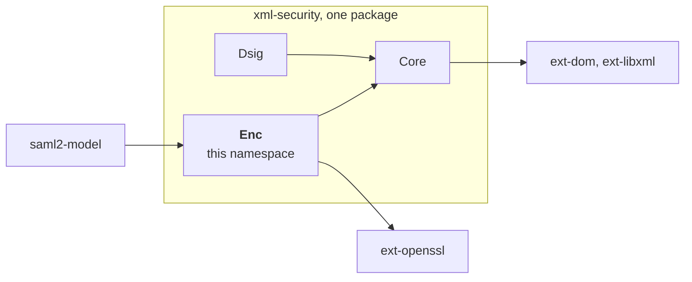

# xml-security, the `Enc` namespace: specification

The `Enc` namespace of `xml-security`, XML Encryption on the safe DOM of `Core`: it decrypts an encrypted element into a document `Core` loaded, and encrypts an element for a peer, with one cipher family, one key transport and one way to fail. It knows no SAML: `saml2-model` decides that an `EncryptedAssertion` holds an `EncryptedData`, and hands the decrypted document to `Dsig` for the signature that follows.

| | |
|---|---|
| Repository | `beffroi-php/xml-security`, one package for the safe DOM, XML Signature and XML Encryption, in three namespaces |
| Package | `beffroi-php/xml-security` |
| Namespace | `Beffroi\Xml\Enc`, on `Beffroi\Xml\Core`, never on `Beffroi\Xml\Dsig`; this document is the law of `Enc` alone |
| Runtime | PHP 8.4 or later, `ext-openssl` and what `Core` requires. RSA-OAEP with a hash other than SHA-1 needs PHP 8.5 (section 13). Nothing else is called from `Enc`. |
| Consumers | `saml2-model`; outside the stack, any XML Encryption profile whose plaintext is a whole element and whose key travels under RSA-OAEP |
| Design | Sub-spike 8e of [spike 8](https://github.com/Spomky-Labs/heidi-design/blob/main/spikes/08-saml/README.md), [decision 0013](https://github.com/Spomky-Labs/heidi-design/blob/main/docs/decisions/0013-saml-formats-xml-ecrits-ici.md) (the invariants of `xml-enc`) and [decision 0014](https://github.com/Spomky-Labs/heidi-design/blob/main/docs/decisions/0014-xml-security-un-seul-paquet.md) (one package) |

This document states what the namespace does, what it refuses and what it guarantees; the code conforms to it, or the document changes first. Section 4 lists the invariants every test enforces, each with the attack class it closes, section 5 the public API, section 6 the order of decryption and of encryption, section 9 the corpus that proves them.

## 1. Why this namespace exists

XML Encryption failed twice in public in the last fifteen years, and both times the cipher was sound.

1. **The mode was the oracle.** CBC with a padding check, the mode XML Encryption 1.0 made mandatory, let an attacker decrypt a message one byte at a time by watching which malformed ciphertexts a peer refused ("How to Break XML Encryption", Jager and Somorovsky, 2011). XML Encryption 1.1 added AES-GCM for that reason, and a verifier that still accepts CBC accepts the attack.
2. **The key transport was the oracle.** RSA PKCS#1 v1.5 key transport lets an attacker unwrap a session key by watching which malformed wrapped keys a peer refuses (Bleichenbacher, 1998); RSA-OAEP with a leaky implementation leaks the same way (Manger, 2001). And a peer that accepts both the old and the new can be made to unwrap a GCM session key under v1.5, so that adding GCM changed nothing ("One Bad Apple", Jager, Paterson and Somorovsky, 2013). What a decryptor accepts must be a closed list, and what it says when it fails must be one thing.
3. **The tag was not checked.** In March 2026 the two PHP bricks that exist decrypted AES-GCM without checking the length of the authentication tag, so that a truncated tag, down to nothing, authenticated anything (CVE-2026-32313, CVE-2026-32600); the primitive of PHP accepts a truncated tag, and a key of the wrong length, and says nothing (measured, section 13).
4. **The plaintext was trusted.** A decrypted assertion is bytes an attacker chose the shape of, parsed by a second path that skipped the rules the first one enforced. What comes out of a decryption is input, and goes through the same loader as everything else.

The namespace answers each with a rule in code: two ciphers and one key transport family by name, every length checked before the primitive sees a byte, one exception with one message for every cryptographic failure, and the plaintext loaded through the consumer's `Loader` before the consumer sees it.

## 2. Position



`Enc` reaches the DOM and libxml through `Core` only, and never reaches `Dsig`: an encrypted assertion is decrypted here into a `Document`, and `saml2-model` hands that document's root to `Dsig`. What `Enc` adds is `ext-openssl`, called in four functions in four files (section 8), and the shape of XML Encryption. The primitives stay where they are: AES-GCM and RSA-OAEP to OpenSSL, the randomness to PHP's `random_bytes()`.

## 3. Threat model

Each row is an incident, the rule that answers it, and where the rule lives. The invariants are numbered in section 4; the corpus cases in section 9.

| Threat | Incident | Rule | Where |
|---|---|---|---|
| Padding oracle on the content | "How to Break XML Encryption" (2011), CBC | CBC and 3DES are refused by name; AES-GCM only, whose tag is checked in length and value | E-1, E-2, `ContentAlgorithm` |
| Padding oracle on the key | Bleichenbacher (1998), Manger (2001), "One Bad Apple" (2013) | RSA PKCS#1 v1.5 key transport is refused by name even next to GCM; RSA-OAEP only; every cryptographic failure is one exception with one message | E-1, E-3, `KeyTransport`, `Decryptor` |
| Truncated or absent tag | CVE-2026-32313 (xmlseclibs), CVE-2026-32600 (simplesamlphp/xml-security), March 2026 | The tag is exactly 16 bytes, the IV exactly 12, the session key exactly the method's length, checked before the primitive is called, which checks none of it (measured) | E-2, `Decryptor` |
| Plaintext parsed by a second path | The parser differentials of `Core` section 3 | The plaintext goes through the consumer's `Loader`, bounds, DOCTYPE and ID rules included, and the consumer receives a `Document` | E-4, `Decryptor` |
| Structure read loosely | The xml-crypto cases of `Dsig` section 3 | `EncryptedData`, `EncryptionMethod`, one `EncryptedKey` in `KeyInfo`, `CipherData` with `CipherValue` only, each read once and counted; `CipherReference`, `EncryptionProperties`, `ReferenceList` refused | E-5, the reading model |
| Key from the message | A `KeyInfo` that names a key the attacker chose | The decryption key is the consumer's; the `KeyInfo` of an `EncryptedKey` is never read | E-6, `Decryptor` |
| Denial of service | A cipher value of a hundred megabytes decoded before anything is checked | The text of every value is bounded before decoding; the plaintext is bounded by `Core` | E-7, E-13 |
| Key or nonce reuse | A session key or an IV used twice under GCM breaks its authentication | A new key and a new IV from `random_bytes()` for every encryption | E-8, `Encryptor` |
| Plaintext without its context | An element encrypted without the namespace declarations it inherits does not parse on the other side, or parses in another namespace | The encryptor canonicalizes the element, which renders every declaration it uses; the decryptor loads what it gets, and what does not load is refused by `Core` | E-9 |
| Weak keys | RSA below 2048 bits | Refused when the key object is built | E-11 |
| Silent primitive | `openssl_decrypt()` and `openssl_private_decrypt()` return `false` | `false` is the one failure; the plaintext is never the empty string | E-3 |

## 4. Invariants

Each invariant is code, never a constructor option or a flag, has at least one test in the corpus of section 9, and names the attack class it closes.

- **E-1. Two ciphers, one key transport family, by name.** `ContentAlgorithm::fromUri()` accepts `aes128-gcm` and `aes256-gcm`; `KeyTransport::of()` accepts `rsa-oaep-mgf1p`, with or without the `DigestMethod` of SHA-1 that names its only hash, and `rsa-oaep` of XML Encryption 1.1 when its `DigestMethod` and `MGF` name the same hash. CBC, 3DES, `aes192-gcm`, RSA PKCS#1 v1.5, key wrapping and key agreement are refused by name, before anything is decoded. Padding oracles, downgrade.
- **E-2. Every length before the primitive.** The unwrapped session key has exactly the length of the content method (16 or 32 bytes); the IV is the first 12 bytes of the cipher value; the tag is its last 16 bytes; at least one byte of ciphertext lies between them. `openssl_decrypt()` accepts a longer key and a shorter tag and says nothing (measured, section 13), so nothing is passed to it that was not checked. The truncated tag.
- **E-3. One failure.** After the reading model has accepted the structure, every cryptographic failure, the unwrap that returns nothing, a session key of the wrong length, a tag or a ciphertext the cipher refuses, an empty plaintext, is `DecryptionFailed` with the one message of section 5.6, whatever happened. Nothing about which step failed is kept, said or timed by the namespace. Padding oracles.
- **E-4. The consumer reads what `Core` loaded.** `Decryptor::decrypt()` returns the `Document` the consumer's `Loader` built from the plaintext bytes, with the ID attributes and the limits the consumer registered; a plaintext `Core` refuses is `Core`'s refusal, named, since the ciphertext was authentic and the content is what is refused. Parser differentials.
- **E-5. The structure is read strictly.** `EncryptedData` has a `Type` of `http://www.w3.org/2001/04/xmlenc#Element`, one `EncryptionMethod`, one `KeyInfo`, one `CipherData`, and no other element child; `KeyInfo` holds exactly one `EncryptedKey`; `EncryptedKey` has one `EncryptionMethod`, an optional `KeyInfo` that is never read, one `CipherData`; `CipherData` holds one `CipherValue` and no `CipherReference`; `EncryptionProperties`, `ReferenceList` and `CarriedKeyName` are refused. Every child is read with `Core`'s `Children`, direct children only. Loose structure.
- **E-6. Keys from the consumer.** The decryption key is what the consumer passes, through a port a key management service implements without handing its key over; the `KeyInfo` of the `EncryptedKey`, the recipient's certificate hint, is never read. Key substitution.
- **E-7. Strict decoding, bounded first.** The cipher values are decoded with `base64_decode($text, true)` after whitespace removal, and the text is bounded before decoding (section 7). Denial of service.
- **E-8. Fresh randomness.** `Encryptor::encrypt()` draws a new session key and a new IV from `random_bytes()` for every call, never reusing either. Nonce reuse.
- **E-9. The plaintext is a self-contained element.** The encryptor encrypts the exclusive canonical form with comments of the element, which renders every namespace declaration the element and its subtree use; the decryptor loads what it gets, and an element that does not parse on its own is refused by `Core`. Context loss.
- **E-10. Four OpenSSL calls, one file each.** `openssl_decrypt()` is called once, in `Decryptor`; `openssl_encrypt()` once, in `Encryptor`; `openssl_private_decrypt()` once, in `PrivateDecryptionKey`; `openssl_public_encrypt()` once, in `PeerKey`. `openssl_pkey_get_private()` and `openssl_pkey_get_public()` are called in the two key classes only. The rules of section 8 enforce it.
- **E-11. RSA of at least 2048 bits.** A decryption key or a peer key that is not RSA, or whose modulus is shorter than 2048 bits, is refused when the key object is built. Weak keys.
- **E-12. Refusals name the rule, never the input; the failure names nothing.** A refusal of the reading model says which invariant refused and never carries the bytes, an algorithm string, a key or a certificate; `DecryptionFailed` says only that the data could not be decrypted.
- **E-13. Bounded.** The text of a `CipherValue`, the decoded length of an `EncryptedKey`'s cipher value and the plaintext, bounded by the constants of section 7 and by `Core`. Denial of service.

## 5. Public API

Everything below is `final`. Value objects are `readonly` with public properties. Every method that refuses input declares what it throws (section 5.6).

### 5.1 Algorithms

```php
namespace Beffroi\Xml\Enc;

enum ContentAlgorithm: string
{
    case Aes128Gcm = 'http://www.w3.org/2009/xmlenc11#aes128-gcm';
    case Aes256Gcm = 'http://www.w3.org/2009/xmlenc11#aes256-gcm';

    public const int IV_BYTES = 12;    // XML Encryption 1.1 §5.2.4: a 96-bit IV before the ciphertext
    public const int TAG_BYTES = 16;   // and a 128-bit authentication tag after it

    /** @throws UnknownContentAlgorithm for every other URI, CBC, 3DES and aes192-gcm included */
    public static function fromUri(string $uri): self;
    public function keyBytes(): int;      // 16 or 32
    public function cipher(): string;     // 'aes-128-gcm' or 'aes-256-gcm', what openssl_encrypt() and openssl_decrypt() take
}

enum OaepHash: string
{
    case Sha1   = 'http://www.w3.org/2000/09/xmldsig#sha1';
    case Sha256 = 'http://www.w3.org/2001/04/xmlenc#sha256';
    case Sha384 = 'http://www.w3.org/2001/04/xmldsig-more#sha384';
    case Sha512 = 'http://www.w3.org/2001/04/xmlenc#sha512';

    /** @throws UnknownKeyTransport for every other URI */
    public static function fromDigestUri(string $uri): self;
    /** @throws UnknownKeyTransport the MGF URIs of XML Encryption 1.1 §5.5.2, mgf1sha1 to mgf1sha512, one per case */
    public static function fromMgfUri(string $uri): self;
    public function mgfUri(): string;
    public function openssl(): string;    // 'sha1', 'sha256', 'sha384', 'sha512', what the fifth parameter of the two RSA functions takes on PHP 8.5
    public function isAvailable(): bool;  // true for Sha1 everywhere; true for the others where the two RSA functions take a digest, PHP 8.5
}

final readonly class KeyTransport
{
    public const string RSA_OAEP_MGF1P = 'http://www.w3.org/2001/04/xmlenc#rsa-oaep-mgf1p';   // XML Encryption 1.0: SHA-1 for the hash and for MGF1
    public const string RSA_OAEP = 'http://www.w3.org/2009/xmlenc11#rsa-oaep';                 // XML Encryption 1.1: DigestMethod and MGF name the hash

    /** RSA-OAEP with $hash for both the OAEP hash and MGF1 */
    public function __construct(public OaepHash $hash) {}

    public static function mgf1p(): self;   // SHA-1, what every interoperability target produces and accepts
    /**
     * The EncryptionMethod of an EncryptedKey, read strictly (6.1 step 2): rsa-oaep-mgf1p with an optional DigestMethod of
     * SHA-1, or rsa-oaep with an optional DigestMethod and an optional MGF naming the same hash, SHA-1 when absent.
     *
     * @throws UnknownKeyTransport for every other Algorithm, and when the hashes differ
     * @throws MalformedEncryption for an OAEPparams, an MGF under rsa-oaep-mgf1p, or any other child
     */
    public static function of(\Dom\Element $encryptionMethod): self;
    /** The URI written into an EncryptionMethod: rsa-oaep-mgf1p for SHA-1, rsa-oaep with a DigestMethod and an MGF otherwise */
    public function uri(): string;
}
```

SHA-1 inside OAEP is not a collision property and is what the interoperability targets use; the closed list keeps it. XML Encryption 1.1's `rsa-oaep` with SHA-256, SHA-384 or SHA-512 is accepted where PHP can express it, both the OAEP hash and the MGF1 hash being the same digest, which is what the fifth parameter of `openssl_public_encrypt()` and `openssl_private_decrypt()` sets on PHP 8.5 (measured, section 13); a `DigestMethod` and an `MGF` that name different hashes are refused by name, and any hash other than SHA-1 on PHP 8.4 is `AlgorithmUnavailable`. `aes192-gcm` is refused because nothing of the stack produces it and a list that stays short stays reviewable.

### 5.2 Keys

```php
interface DecryptionKeyInterface
{
    /**
     * The session key $wrapped carries under RSA-OAEP with $hash, or null when it does not unwrap: the port never says why.
     *
     * @throws AlgorithmUnavailable when this build cannot unwrap under $hash (any hash other than SHA-1 before PHP 8.5)
     */
    public function unwrap(string $wrapped, OaepHash $hash): ?string;
}

final readonly class PrivateDecryptionKey implements DecryptionKeyInterface
{
    /** @throws InvalidKey when the PEM holds no private key, a wrong passphrase, or a key that is not RSA of at least 2048 bits */
    public static function fromPem(#[\SensitiveParameter] string $pem, #[\SensitiveParameter] ?string $passphrase = null): self;
}

final readonly class PeerKey
{
    /** @throws InvalidKey when the PEM holds no certificate, or a key that is not RSA of at least 2048 bits */
    public static function fromCertificatePem(string $pem): self;
    /** @throws InvalidKey the content of an X509Certificate element, base64 of the DER, whitespace tolerated */
    public static function fromCertificateBase64(string $base64): self;
    /** @throws InvalidKey a PEM public key */
    public static function fromPublicKeyPem(string $pem): self;
}
```

`DecryptionKeyInterface` is the one port of the namespace: a key management service unwraps without ever handing its key over, and answers `null` rather than a reason, so that the port itself cannot become the oracle. `PrivateDecryptionKey` is the implementation on a PEM in memory. `PeerKey` is the encryption certificate of the peer's metadata, read the way `Dsig`'s `VerificationKey` reads a signing certificate: `openssl_pkey_get_public()` on the PEM armour, no DER parser; whether the certificate is expired or trusted is the metadata layer's business.

### 5.3 The reading model

```php
final readonly class EncryptedData
{
    /**
     * The xenc:EncryptedData element read strictly (E-5), nothing decrypted.
     *
     * @throws MalformedEncryption when the structure, a Type, a base64 text or a length is not what 5.3 says
     * @throws UnknownContentAlgorithm, UnknownKeyTransport, LimitExceeded
     * @throws ForeignNode when $element is not of a document of the brick
     */
    public static function of(\Dom\Element $element): self;

    public function __construct(
        public \Dom\Element $element,
        public ContentAlgorithm $algorithm,
        public EncryptedKey $key,
        public string $cipherValue,          // decoded: IV, ciphertext, tag; at least IV_BYTES + 1 + TAG_BYTES bytes
    ) {}
}

final readonly class EncryptedKey
{
    public function __construct(
        public \Dom\Element $element,
        public KeyTransport $transport,
        public string $cipherValue,          // decoded, 256 to maxEncryptedKeyBytes bytes
    ) {}
}
```

The `KeyInfo` of the `EncryptedKey` has no class: it is never read (E-6). `CipherReference`, `EncryptionProperties`, `ReferenceList` and `CarriedKeyName` have no class: they are refused (E-5). `EncryptedKey` is read inside the `KeyInfo` of `EncryptedData`, the form SimpleSAMLphp's library and xmlsec1 produce and SAML Core §6.1 allows; the sibling form, an `EncryptedKey` next to `EncryptedData` under `EncryptedAssertion`, is left to section 12.

### 5.4 Decryption

```php
final readonly class Decryptor
{
    /** @param Loader $loader the consumer's, with its ID attributes and limits: it loads the plaintext (E-4) */
    public function __construct(private Loader $loader) {}

    /**
     * @param \Dom\Element $encrypted the xenc:EncryptedData element, the child of a saml:EncryptedAssertion
     * @throws EncryptionRefused the reading model's refusals, naming the rule (E-12)
     * @throws DecryptionFailed the one failure of E-3
     * @throws AlgorithmUnavailable a hash this build cannot unwrap under
     * @throws \Beffroi\Xml\Core\Exception\RefusedXml what Core refuses of the plaintext (E-4)
     * @throws ForeignNode when $encrypted is not of a document of the brick
     */
    public function decrypt(\Dom\Element $encrypted, DecryptionKeyInterface $key): Document;
}
```

The consumer reads `$document->root()`, the decrypted element as `Core` loaded it, and hands it to `Dsig` when it is signed. Nothing of the encrypted element is kept.

### 5.5 Encryption

```php
final readonly class Encryptor
{
    public function __construct(private Canonicalizer $canonicalizer = new Canonicalizer()) {}

    /**
     * A new xenc:EncryptedData element, built in the document of $element and returned unattached, holding the
     * exclusive canonical form with comments of $element under a fresh session key and IV, the key under RSA-OAEP
     * to $peer. The consumer puts it where its protocol says and removes the plaintext element itself.
     *
     * @param ?string $certificatePem when given, the KeyInfo of the EncryptedKey carries it, for peers that want the hint
     * @throws AlgorithmUnavailable a hash this build cannot wrap under
     * @throws \InvalidArgumentException when $element is not connected to its document, or its default namespace is undeclared (core.md 6.3)
     * @throws EncryptionFailed when a primitive fails: never input
     * @throws ForeignNode when $element is not of a document of the brick
     */
    public function encrypt(
        \Dom\Element $element,
        PeerKey $peer,
        ContentAlgorithm $algorithm = ContentAlgorithm::Aes256Gcm,
        KeyTransport $transport = new KeyTransport(OaepHash::Sha1),
        ?string $certificatePem = null,
    ): \Dom\Element;
}
```

The element comes back in the same document because `Core` offers no `importNode()`: a consumer that encrypts the assertion of a response it built replaces the assertion with an `EncryptedAssertion` holding what `encrypt()` returned, then serializes the response with `Core`. The plaintext is the canonical form, so it carries every declaration it uses (E-9) and is what the peer will parse; a built element whose default namespace is undeclared is refused by `Core`'s canonicalizer before anything is encrypted.

### 5.6 Exceptions

```php
namespace Beffroi\Xml\Enc\Exception;

use Beffroi\Xml\Core\Exception\RefusedXml;

abstract class EncryptionRefused extends RefusedXml {}

final class MalformedEncryption extends EncryptionRefused {}      // E-5, E-7: the structure is not the one of 5.3
final class UnknownContentAlgorithm extends EncryptionRefused {}  // E-1
final class UnknownKeyTransport extends EncryptionRefused {}      // E-1
final class AlgorithmUnavailable extends EncryptionRefused {}     // an OAEP hash other than SHA-1 before PHP 8.5
final class DecryptionFailed extends EncryptionRefused {}         // E-3: "The data could not be decrypted (E-3).", the one message
final class InvalidKey extends EncryptionRefused {}               // E-11, or no key in the PEM
final class LimitExceeded extends EncryptionRefused {}            // E-13, the bound named
final class EncryptionFailed extends \RuntimeException {}         // a primitive failed while encrypting: never input
```

An `EncryptionRefused` is input the namespace refuses; it extends `Core`'s `RefusedXml`. `DecryptionFailed` carries the one message `The data could not be decrypted (E-3).` whatever failed, and the test of section 9.2 asserts that message over every failing fixture.

## 6. Processing rules

### 6.1 Decryption, in order

`Decryptor::decrypt($encrypted, $key)`:

1. **Ownership.** `Document::owning($encrypted)` (`ForeignNode` otherwise).
2. **The reading model.** `EncryptedData::of()` reads the structure of 5.3 with `Core`'s `Children`, `Attributes` and `Text`, refusing at the first fault: the element is a `xenc:EncryptedData`; its `Type` is `http://www.w3.org/2001/04/xmlenc#Element` (a missing `Type`, `Content` or anything else is a refusal: the plaintext is a whole element or nothing); the `Algorithm` of its `EncryptionMethod` goes through `ContentAlgorithm::fromUri()` (E-1), and the element has no child (a `KeySize` or an `OAEPparams` is a refusal); its `KeyInfo` holds exactly one `EncryptedKey` and nothing else; the `EncryptedKey`'s `EncryptionMethod` is `rsa-oaep-mgf1p` with an optional `ds:DigestMethod` that names SHA-1, the one hash MGF1 uses under that name (XML Encryption 1.0 §5.4.2, the shape Shibboleth and ADFS write), or `rsa-oaep` with an optional `ds:DigestMethod` and an optional `xenc11:MGF` naming the same hash, SHA-1 when absent (XML Encryption 1.1 §5.5.2), through `OaepHash::fromDigestUri()` and `fromMgfUri()` (E-1); an `OAEPparams`, an `MGF` under `rsa-oaep-mgf1p` and any other child are refusals; the `EncryptedKey`'s `KeyInfo` is not read; each `CipherData` holds one `CipherValue` and no `CipherReference`; both cipher values are decoded (E-7) and their lengths checked: the key's between 256 and `maxEncryptedKeyBytes` bytes, the data's at least `IV_BYTES + 1 + TAG_BYTES` (E-2, E-13).
3. **Availability.** A hash this build cannot unwrap under is `AlgorithmUnavailable`, before any key is touched.
4. **The session key.** `$key->unwrap($encryptedKey->cipherValue, $transport->hash)`; `null` is `DecryptionFailed` (E-3); a key whose length is not `$algorithm->keyBytes()` is `DecryptionFailed` (E-2).
5. **The content.** The IV is the first `IV_BYTES` of the data's cipher value, the tag its last `TAG_BYTES`, the ciphertext what lies between; `openssl_decrypt($ciphertext, $algorithm->cipher(), $sessionKey, OPENSSL_RAW_DATA, $iv, $tag)`; `false` or `''` is `DecryptionFailed` (E-3).
6. **The result.** `$this->loader->load($plaintext)` gives the `Document` (E-4): the same loader as everything else, so the same bounds, the same DOCTYPE and ID rules. What `Core` refuses there is `Core`'s refusal.

Steps 4 and 5 fail in one way: the same class, the same message, and nothing kept. The namespace does not attempt to make the two failures take the same time; the measured cost of a failing unwrap is that of a succeeding one (section 13), and the tag check of GCM is constant-time inside OpenSSL.

### 6.2 Encryption, in order

`Encryptor::encrypt($element, $peer, $algorithm, $transport, $certificatePem)`:

1. **Availability.** A hash this build cannot wrap under is `AlgorithmUnavailable`.
2. **The plaintext.** `Canonicalizer::canonicalize($element, CanonicalizationMethod::ExclusiveWithComments)`: a self-contained element, every declaration it uses rendered (E-9), the refusals of `Core` 6.3 first.
3. **The randomness.** `random_bytes($algorithm->keyBytes())` for the session key, `random_bytes(ContentAlgorithm::IV_BYTES)` for the IV (E-8).
4. **The content.** `openssl_encrypt($plaintext, $algorithm->cipher(), $sessionKey, OPENSSL_RAW_DATA, $iv, $tag, '', ContentAlgorithm::TAG_BYTES)`; `false` is `EncryptionFailed`; the cipher value is the IV, the ciphertext and the tag, in that order (XML Encryption 1.1 §5.2.4).
5. **The key.** `$peer->wrap($sessionKey, $transport->hash)`, the one `openssl_public_encrypt()` of the namespace under `OPENSSL_PKCS1_OAEP_PADDING` and, for a hash other than SHA-1, the digest parameter of PHP 8.5.
6. **The element.** Built with `createElementNS()` and a prefix on every element (the rule of [core.md](core.md) 6.5 for a built tree), `xenc` for XML Encryption, `ds` for `KeyInfo` and its children, `xenc11` for an `MGF`: `EncryptedData` with `Type`, its `EncryptionMethod`, its `KeyInfo` holding the `EncryptedKey` with its `EncryptionMethod` (and, under `rsa-oaep`, the `DigestMethod` and the `MGF`), its `KeyInfo/X509Data/X509Certificate` when `$certificatePem` is given, its `CipherData/CipherValue`; then the data's `CipherData/CipherValue`, both as base64 with a line break every 76 characters. The element is returned unattached, in the document of `$element`.

## 7. Limits

Constants of the namespace, never options.

| Bound | Value | Why |
|---|---|---|
| `maxCipherValueBytes` | 2 097 152 of text | The plaintext is bounded by `Core`'s `maxBytes`, 1 MiB by default and 8 MiB at the ceiling; a mebibyte of plaintext is 1 398 160 characters of base64 with its IV and tag. Two mebibytes of text leave the room and stop a cipher value of a hundred megabytes before it is decoded. A consumer who raised `maxBytes` to its ceiling has a case this document does not know. |
| `maxEncryptedKeyBytes` | 1 024 decoded | RSA-2048 wraps in 256 bytes, RSA-8192 in 1 024; a value under 256 bytes is refused too (E-11). |
| `IV_BYTES`, `TAG_BYTES` | 12, 16 | XML Encryption 1.1 §5.2.4, and what GCM was standardised with (NIST SP 800-38D). |
| The session key | exactly `keyBytes()` of the method | A longer key decrypts under `openssl_decrypt()` (measured); nothing but the exact length reaches it. |

## 8. What is refused, what is never called

**Refused as input**, always, each with its named rule: `aes128-cbc`, `aes192-cbc`, `aes256-cbc`, `tripledes-cbc`, `aes192-gcm`, key wrapping (`kw-*`), key agreement, `rsa-1_5`, an `rsa-oaep` whose `DigestMethod` and `MGF` differ, a `DigestMethod` other than SHA-1 or an `MGF` under `rsa-oaep-mgf1p`, `OAEPparams`, a `Type` other than `Element`, `CipherReference`, `EncryptionProperties`, `ReferenceList`, `CarriedKeyName`, a second `EncryptedKey`, a `KeySize`, a key that is not RSA of at least 2048 bits.

**Never called, in the namespace**, enforced by the rules of `.ci-tools/phpstan.neon`: `openssl_decrypt()` outside `Decryptor`, `openssl_encrypt()` outside `Encryptor`, `openssl_private_decrypt()` outside `PrivateDecryptionKey`, `openssl_public_encrypt()` outside `PeerKey`, `openssl_pkey_get_private()` and `openssl_pkey_get_public()` outside the two key classes; `openssl_private_encrypt()` and `openssl_public_decrypt()` (raw RSA); `openssl_cipher_iv_length()` and `openssl_cipher_key_length()` (the lengths are constants of this document, not answers of OpenSSL); `openssl_random_pseudo_bytes()` (`random_bytes()` is the source); `openssl_x509_*()`; `hash_hmac()`; the constants `OPENSSL_PKCS1_PADDING`, `OPENSSL_NO_PADDING`, `OPENSSL_ZERO_PADDING`; the token `cbc` anywhere in `src/Enc/`. Everything [core.md](core.md) section 8 bans is banned here too.

## 9. Acceptance

The namespace is accepted when every case below is a green test in CI on PHP 8.4 and 8.5, when Infection leaves no escaped mutant in `Decryptor`, `Encryptor`, `EncryptedData`, `EncryptedKey`, `ContentAlgorithm`, `OaepHash`, `KeyTransport`, `PrivateDecryptionKey` and `PeerKey`, when the vectors of 9.1 decrypt, and when SimpleSAMLphp's library decrypts what the encryptor produces and the decryptor accepts what it encrypts (the judge of sub-spike 8e, 9.4). Two mutants are ignored by configuration, the `throw` of `AlgorithmUnavailable`, reached on PHP 8.4 only while the mutation job runs on 8.5, and the `throw` of `EncryptionFailed`, which the primitives never reach with a key the constructor accepted.

### 9.1 Vectors

The valid encryptions the decryptor must accept come from xmlsec1 1.3.7 on OpenSSL in Alpine 3.22, over the test key pair of `tests/Dsig/Fixture/keys/`, with the exact command next to each fixture under `tests/Enc/Fixture/vectors/`:

| Vector | Encrypted with | Expected |
|---|---|---|
| An assertion, `aes256-gcm`, `rsa-oaep-mgf1p`, the certificate in the key's `KeyInfo` | xmlsec1 `--encrypt --session-key aes-256-gcm` | decrypts; the `Document` has one root, the assertion, with its ID indexed and its text readable |
| The same under `aes128-gcm` | `--session-key aes-128-gcm` | decrypts |
| The same, the key's `KeyInfo` absent | | decrypts: it is never read |
| The same, a `DigestMethod` of SHA-1 under `rsa-oaep-mgf1p`, the shape Shibboleth and ADFS write | the template so changed | decrypts |
| The same under `rsa-oaep` with SHA-256 for the digest and MGF1 | a template naming `rsa-oaep` with a `DigestMethod` and an `MGF` of SHA-256, which xmlsec1 fills | decrypts on PHP 8.5; `AlgorithmUnavailable` on 8.4 |
| A signed assertion encrypted, decrypted, then verified by `Dsig` with the test certificate | the signer of `Dsig` then xmlsec1 | the round trip of the SAML stack: decrypt, load, verify |
| An assertion holding a comment | the same, a comment inside the `NameID` | decrypts with the comment: xmlsec1 keeps it in the plaintext |

### 9.2 Hostile corpus

One fixture file per case under `tests/Enc/Fixture/hostile/`, each a variant of a valid vector with the one change that must refuse it, decrypted with the test key, each asserting the named exception; every case of the second half asserts the one message of E-3.

| Case | Exception |
|---|---|
| `EncryptionMethod` `aes128-cbc`, then `aes256-cbc`, then `tripledes-cbc` | `UnknownContentAlgorithm` (E-1) |
| `EncryptionMethod` `aes192-gcm` | `UnknownContentAlgorithm` |
| The key's `EncryptionMethod` `rsa-1_5` | `UnknownKeyTransport` (E-1) |
| The key's `EncryptionMethod` `kw-aes256` | `UnknownKeyTransport` |
| `rsa-oaep` with `DigestMethod` sha256 and `MGF` mgf1sha1 | `UnknownKeyTransport`: the hashes differ (E-1) |
| `rsa-oaep` with `DigestMethod` sha256 and no `MGF` | `UnknownKeyTransport`: the MGF defaults to SHA-1, the hashes differ |
| `rsa-oaep-mgf1p` with a `DigestMethod` of sha256 | `UnknownKeyTransport`: MGF1 is SHA-1 under that name, the hashes differ |
| `rsa-oaep-mgf1p` with an `MGF` child | `MalformedEncryption` (E-5) |
| `rsa-oaep-mgf1p` with an `OAEPparams` child | `MalformedEncryption` (E-5) |
| A `Type` of `Content`, then no `Type` | `MalformedEncryption` (E-5) |
| A `CipherReference` in place of the `CipherValue` | `MalformedEncryption` (E-5) |
| An `EncryptionProperties` child, then a `ReferenceList` inside the key, then a `CarriedKeyName` | `MalformedEncryption` (E-5) |
| Two `EncryptedKey` in the `KeyInfo`, then none | `MalformedEncryption` (E-5) |
| A `KeySize` under the content's `EncryptionMethod` | `MalformedEncryption` (E-5) |
| A cipher value with a character outside the base64 alphabet, then empty | `MalformedEncryption` (E-7) |
| A cipher value text of `maxCipherValueBytes` + 1 | `LimitExceeded` (E-13) |
| A data cipher value of 28 decoded bytes, an IV and a tag with nothing between | `MalformedEncryption` (E-2) |
| A key cipher value of 255 bytes, then of 1 025 | `LimitExceeded` (E-13) |
| The key wrapped under the stranger's certificate | `DecryptionFailed` (E-3) |
| The key wrapped under PKCS#1 v1.5 padding but declared `rsa-oaep-mgf1p` | `DecryptionFailed` |
| The wrapped key altered by one byte | `DecryptionFailed` |
| A 32-byte session key wrapped, the content declared `aes128-gcm` | `DecryptionFailed` (E-2): the length, before the primitive would have accepted it |
| A 16-byte session key wrapped, the content declared `aes256-gcm` | `DecryptionFailed` |
| The tag truncated to 15 bytes, the cipher value shortened by one | `DecryptionFailed`: the 16 last bytes are a tag that does not verify (E-2) |
| The tag altered by one byte, then the ciphertext, then the IV | `DecryptionFailed` |
| A ciphertext that decrypts to an empty plaintext | not reachable: GCM authenticates the ciphertext, an empty one under a valid tag has no ciphertext byte, refused by the model |
| The plaintext holding a DOCTYPE | `DoctypeRefused` from `Core` (E-4): the ciphertext was authentic |
| The plaintext holding two root elements | `MalformedXml` from `Core` (E-4) |
| The plaintext larger than `maxBytes` | `LimitExceeded` from `Core` (E-4) |
| The plaintext an element without its namespace declaration, a `saml:Assertion` whose `xmlns:saml` was stripped before encryption | `ParserDiagnostic` from `Core` (E-9) |
| A decryption key of 1024 bits, then an EC key, then a DSA key | `InvalidKey` (E-11) |
| A peer certificate of 1024 bits, then an EC one | `InvalidKey` (E-11) |
| Every failing fixture of the `DecryptionFailed` rows | the same message, `The data could not be decrypted (E-3).`, and no other property of the exception |
| The encrypted element from a document parsed outside the loader | `ForeignNode` |

### 9.3 Behaviour corpus

| Case | Expected |
|---|---|
| `decrypt()` on a vector | a `Document` whose root is the plaintext element, its ID indexed, its `Issuer` readable with `Children::one()` and `Text::of()` |
| `decrypt()` twice on the same element | the same canonical bytes of the root |
| `encrypt()` then `decrypt()` on a built assertion, `aes256-gcm` and `aes128-gcm`, SHA-1 | the root's exclusive canonical form with comments is the plaintext that was encrypted |
| `encrypt()` under `rsa-oaep` with SHA-256, then decrypted | decrypts on PHP 8.5; `AlgorithmUnavailable` on 8.4 before anything is encrypted |
| `encrypt()` twice on the same element | two different cipher values and two different wrapped keys (E-8) |
| `encrypt()` returns an element of the given document, unattached | `ownerDocument` is the same, `parentNode` is null; appended under an `EncryptedAssertion` the consumer built, the response serializes with `Core` and loads again |
| `encrypt()` with a certificate | the key's `KeyInfo/X509Data/X509Certificate` holds its base64; without, no `KeyInfo` under the key |
| `encrypt()` of an element with comments and inherited declarations | the plaintext is the exclusive canonical form with comments, the declarations rendered on the element (E-9) |
| A signed assertion (the signer of `Dsig`) encrypted, decrypted, verified by `Dsig` | the stack's round trip is green |
| xmlsec1 decrypts what `encrypt()` produced | the command recorded in the fixture README, for `aes256-gcm` and `aes128-gcm` |
| `encrypt()` of a built element whose default namespace is undeclared | the `\InvalidArgumentException` of `Core`'s canonicalizer, before anything is encrypted |
| `ContentAlgorithm::fromUri()` and `OaepHash::fromDigestUri()` round-trip each case | the URI comes back |
| `KeyTransport::uri()` | `rsa-oaep-mgf1p` for SHA-1, `rsa-oaep` otherwise |
| `OaepHash::isAvailable()` | `true` for SHA-1 everywhere, the others where the RSA functions take a digest, PHP 8.5 |
| `DecryptionKeyInterface` implemented by a test | its answer is the session key; `null` is `DecryptionFailed` |
| `PeerKey::fromCertificateBase64()` of the test certificate with line breaks | builds |
| An `EncryptionRefused` message | ends with the rule in parentheses, holds no URI, no base64 and no key |

### 9.4 Real documents

Under `tests/Enc/Fixture/real/`, each named with its origin and the date it was captured:

- SimpleSAMLphp: what signs, verifies, encrypts and decrypts inside it is its library `simplesamlphp/saml2` on `xmlseclibs`, which names `aes128-gcm`, `aes256-gcm`, `rsa-oaep-mgf1p` and `rsa-oaep`. Its `EncryptedAssertion::setAssertion()` picks AES-128-CBC for the content whenever the key it is given is an RSA key (section 13), so the real fixture is what `XMLSecEnc` produces under the test certificate, an AES-GCM session key wrapped under RSA-OAEP, the shape the library reads back with `EncryptedAssertion::getAssertion()`. The decryptor accepts that fixture with the test key, and the reverse, the library decrypting what the encryptor produced, is recorded with its scripts next to those of `Dsig` in `tests/Dsig/Fixture/real/simplesamlphp/`.
- Entra and ADFS encrypt the assertions they issue with `aes256-cbc` under `rsa-oaep-mgf1p` when a tenant enables token encryption; decision 0013 refuses CBC, so those documents are refused by name (`UnknownContentAlgorithm`) and no capture is planned: the tenant leaves encryption off, and the question of section 12 records the trade-off.

### 9.5 Performance

One soft assertion in the suite, skipped outside CI: decrypting an encrypted assertion of the size of SimpleSAMLphp's, the load included, takes less than 10 ms.

### 9.6 Test form

The form of [core.md](core.md) 9.6, unchanged; fixtures under `tests/Enc/Fixture/{vectors,hostile,behaviour,real}/`; one test class per class of `src/Enc/`, plus `TraceabilityTest` over this document and a `SourceGuardTest` over `src/Enc/`.

### 9.7 Adversarial pass

Once the corpus above is green, each row of section 3 is attacked with inputs the corpus does not list: algorithm URIs that differ by case, a slash or a fragment; a cipher value with whitespace, padding and alphabet tricks; an IV of every length around 12 and a tag of every length around 16, obtained by shortening and lengthening the cipher value; a wrapped key of the modulus length filled with zeros, with ones, with the value of the modulus; the `EncryptedKey` moved next to the `EncryptedData`; a `Type` of `Element` in another case; a plaintext that is a valid assertion followed by a second root; a plaintext holding an `EncryptedData` (nested encryption); keys of every wrong kind. Every attempt is a fixture whatever its outcome, asserted with the exception and the message it got, and every failing decryption of the pass is checked to carry the one message of E-3.

## 10. Repository

In the tree of [core.md](core.md) section 10:

```
spec/enc.md            this document
src/Enc/               ContentAlgorithm, OaepHash, KeyTransport, DecryptionKeyInterface, PrivateDecryptionKey, PeerKey,
                       EncryptedData, EncryptedKey, Decryptor, Encryptor, Exception/, Internal/ (the names, the base64 and the
                       structure helpers, as Dsig has them)
tests/Enc/             Unit/ (one class per class of src/Enc/, plus TraceabilityTest, SourceGuardTest, AdversarialTest,
                       RealDocumentsTest, PerformanceTest, Regression/), Support/, Fixture/ (vectors, hostile, behaviour, real,
                       each directory with a README carrying the commands)
.ci-tools/             phpstan.neon extended with the confinements of section 8; deptrac.yaml's Enc layer, on Core only, never on
                       Dsig; the strict Infection list of section 9 in .castor/qa.php
```

## 11. Out of scope

- CBC and 3DES, and with them the encrypted assertions of Entra and ADFS as their tenants configure them today (section 12).
- RSA PKCS#1 v1.5 key transport, key wrapping (`kw-aes128`, `kw-aes256`), key agreement (ECDH-ES, DH), `EncryptedKey` chains.
- `Type` other than `Element`: the encryption of content, of attributes, of arbitrary octets.
- `CipherReference`, `EncryptionProperties`, `ReferenceList`, `CarriedKeyName`, `Recipient`.
- The SAML semantics of `EncryptedAssertion`, `EncryptedID` and `EncryptedAttribute`: `saml2-model`.
- Reading the `KeyInfo` of an `EncryptedKey`: a consumer who wants the hint reads it with `Core`.

## 12. Left to the sub-spike

- Whether the `EncryptedKey` next to the `EncryptedData`, the sibling form SAML Core §6.1 also allows, is accepted, once a real producer that uses it is captured.
- CBC and the interoperability targets: Entra and ADFS encrypt under `aes256-cbc`; decision 0013 refuses CBC. The trade-off, the SP role refusing their encrypted assertions against a padding oracle the profile would have to close some other way, is the product's, recorded on the epic.
- The performance figure of 9.5, once the fixtures exist.

## 13. Sources

**Specifications.**

- XML Encryption Syntax and Processing Version 1.1, W3C Recommendation, 11 April 2013: §3.4 `EncryptionMethod`, §3.5 `EncryptedKey`, §4.1 the encryption process, §4.2 the decryption process, §5.2.4 AES-GCM (a 96-bit IV before the ciphertext, a 128-bit tag after it), §5.5.2 RSA-OAEP (`rsa-oaep-mgf1p` of version 1.0, `rsa-oaep` with `DigestMethod` and `MGF`, SHA-1 when absent). https://www.w3.org/TR/xmlenc-core1/
- RFC 8017, PKCS #1 v2.2, §7.1 RSAES-OAEP, §7.2 RSAES-PKCS1-v1_5. https://www.rfc-editor.org/rfc/rfc8017
- NIST SP 800-38D, Galois/Counter Mode, §5.2.1 (the 96-bit IV), §8 (uniqueness of the IV under one key).
- Assertions and Protocols for the OASIS SAML V2.0, §2.3.4 `EncryptedAssertion`, §6.1 (the `EncryptedKey` inside the `KeyInfo` of the `EncryptedData` or next to it). https://docs.oasis-open.org/security/saml/v2.0/saml-core-2.0-os.pdf

**Incidents.**

- Jager and Somorovsky, "How to Break XML Encryption", ACM CCS 2011: the CBC padding oracle on XML Encryption 1.0.
- Jager, Paterson and Somorovsky, "One Bad Apple: Backwards Compatibility Attacks on State-of-the-Art Cryptography", NDSS 2013: a peer that accepts PKCS#1 v1.5 next to OAEP, or CBC next to GCM, is broken as if it accepted only the old.
- Bleichenbacher, "Chosen Ciphertext Attacks Against Protocols Based on the RSA Encryption Standard PKCS #1", CRYPTO 1998; Manger, "A Chosen Ciphertext Attack on RSA Optimal Asymmetric Encryption Padding", CRYPTO 2001.
- CVE-2026-32313, GHSA-4v26-v6cg-g6f9, and CVE-2026-32600, GHSA-r353-4845-pr5p, 13 March 2026: missing AES-GCM authentication tag validation in xmlseclibs and simplesamlphp/xml-security, as decision 0013 records.

**Measurements, 27 September 2026**, in `ghcr.io/spomky-labs/phpqa` (PHP 8.4.25 and 8.5.10, OpenSSL 3.5.7) and in Alpine 3.22 (OpenSSL 3.5.8, xmlsec1 1.3.7).

- `openssl_decrypt()` in `aes-128-gcm` returns the plaintext under a 32-byte key, the extra bytes ignored, and under a tag truncated to 15 bytes; it returns `false` under a 16-byte key declared `aes-256-gcm`, a 16-byte or 8-byte IV, a 17-byte tag, an empty tag, no tag, a tampered tag and a tampered ciphertext. `openssl_cipher_iv_length()` gives 12 for the three GCM ciphers, `openssl_cipher_key_length()` 16, 24 and 32; the tag `openssl_encrypt()` writes with a tag length of 16 is 16 bytes.
- `openssl_public_encrypt()` and `openssl_private_decrypt()` take a padding only on PHP 8.4; on PHP 8.5 they take a fifth parameter, the digest, and the OpenSSL command line decrypts what PHP wrapped under `sha256`, `sha384` or `sha512` with `rsa_oaep_md` and `rsa_mgf1_md` set to that same digest, and fails when `rsa_mgf1_md` differs: the parameter sets both hashes. A blob wrapped under `sha256` does not unwrap under the default, SHA-1. `openssl_pkey_encrypt()` and `openssl_pkey_decrypt()` do not exist on either version.
- An OAEP unwrap of a blob wrapped under PKCS#1 v1.5, or of a blob of the wrong length, returns `false`; twenty failing unwraps cost 7 ms, twenty succeeding ones 8 ms.
- xmlsec1 1.3.7 encrypts a `saml:Assertion` from a template holding `aes256-gcm`, `rsa-oaep-mgf1p` and the test certificate (`--encrypt --lax-key-search --pubkey-cert-pem cert.pem --session-key aes-256-gcm --xml-data data.xml`), `--node-id` naming the element of the data file to encrypt, and its output is the data file with that element replaced by the filled template; it fills a template naming `rsa-oaep` with a `DigestMethod` and an `MGF` of SHA-256 as well, and decrypts its own output with the private key to the same bytes, a comment inside the plaintext included. The plaintext it encrypts is the element dumped with the namespace declarations the element itself carries and none it inherits: an assertion nested in a response that declares `xmlns:saml` for it is encrypted without the declaration, and xmlsec1 reads it back only because it parses the plaintext in the context of the parent. The vectors of 9.1 declare `xmlns:saml` on the assertion; the nested form without it is the hostile case of E-9.
- xmlseclibs 3.1.5 names `AES128_GCM`, `AES192_GCM`, `AES256_GCM`, `AES128_CBC`, `AES192_CBC`, `AES256_CBC`, `TRIPLEDES_CBC`, `RSA_OAEP_MGF1P` and `RSA_OAEP`, and its `XMLSecEnc::encryptKey()` writes the `EncryptionMethod` of an `EncryptedKey` with no child under both RSA-OAEP names, SHA-1 for the hash and the MGF by default. `simplesamlphp/saml2` 4.20.3's `EncryptedAssertion::setAssertion()` wraps an AES-128-CBC session key when the key it is given is an RSA key, and shares the symmetric key with no `EncryptedKey` when it is an AES key: AES-GCM under RSA-OAEP comes from `XMLSecEnc::encryptKey()` then `encryptNode()`, called directly.
- Microsoft Entra ID's token encryption and ADFS's assertion encryption use `aes256-cbc` with `rsa-oaep-mgf1p`, per their documentation; neither offers GCM.
- From the sources, not measured: OpenSAML's default `RSAOAEPParameters` name SHA-1 for the digest and `mgf1sha1` for the MGF, and Santuario writes that `DigestMethod` under `rsa-oaep-mgf1p`, which is the shape of an assertion Shibboleth encrypts, under `aes128-gcm` by default since its IdP version 4; .NET's `EncryptedXml`, behind ADFS and Entra, writes the same child.
